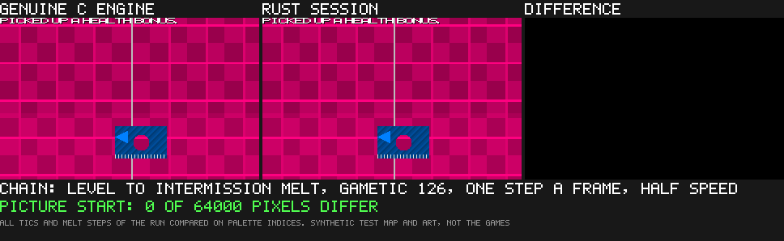
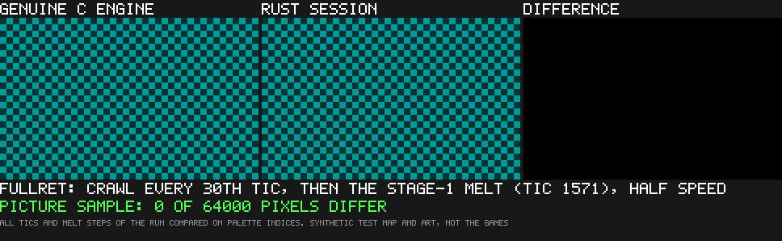

# M6a evidence record: the level chain, up to the owner's hand test

**Status (2026-11-25, America/Los_Angeles): M6a parts 1 and 2 are merged and closed out.** Part 2 is pull request #80 and its
follow-up #84, both merged on 2026-11-25. The hitching finding of §9 is closed as not an engine defect, and the closeout's
other notes (the README's evidence sum, the leak-detection check, the quirk index correction) are in
[§14](#14-the-closeout-2026-11-25). Not built in M6a's merged parts: the easy skills and E1M7 on skill 3, which are wire 28 ([record](WIRE28.md)).
The paragraphs below are earlier status lines, left as written.

**Status (2026-11-23, America/Los_Angeles): M6a part 1 is merged** ([PR #65](https://github.com/Copgunn/DOOM/pull/65), 2026-11-23), and
so is the held-keys fix of [§5.8](#58-held-keys-at-a-level-load-2026-11-23-after-part-1-merged)
([PR #79](https://github.com/Copgunn/DOOM/pull/79), the same day). Part 2 (the finale and the melt pictures, pull request #80, merged 2026-11-25) is
recorded in sections 6 to 12, its follow-up (pull request #84) in [§13](#13-the-follow-up-pull-request-84-2026-11-25); it passed the owner's hand test on 2026-11-24 ([§9](#9-the-owners-hand-test-of-9e3734ae-and-his-five-sessions-against-the-genuine-engine-2026-11-24)).
The paragraph below is the status as written on 2026-11-22, before the merge, and is left as it was.

**Status (2026-11-22, America/Los_Angeles): this is the record up to the hand-test gate, not the finished milestone.** The
playable level chain (exits, intermission, carried start, reborn, secret route) is built and compared; the PR stops next for the
owner's hand test. Not built yet, each a typed refusal or a declared gap: the finale after E1M8, the melt pictures (the wipe's
draws are made and compared, the picture changes at once), the easy skills 0 and 1, and E1M7 on skill 3. Steps 10 to 17 follow
the hand test and will extend this record. The gates run at the final code head are in [§4](#4-gates-at-the-final-code-head);
what was not run is in [Not run](#not-run-and-limits). **After the gate (2026-11-22 evening):** the owner's first hand test, the
rebuilt chain CH2 and the wire-26 constructor fix are in [§5](#5-after-the-hand-test-gate-2026-11-22-evening).

Observations only. [TESTING](../TESTING.md#the-playable-level-chain-steps-4-to-9) owns the commands,
[COMPATIBILITY](../COMPATIBILITY.md#episode-1-as-one-session-m6a) the support statement, the
[investigation note](../M6A_REFERENCE_INVESTIGATION.md) the C facts and rulings, and [ROADMAP](../ROADMAP.md) the status. Exact
review state and CI belong to GitHub. Counts, pass or fail facts and result digests only: nothing from the IWAD's lumps, names,
coordinates or geometry is recorded.

## 1. The real-map comparison (step 8), local only

**What ran.** `tools/local/m6a_session_real.py` ran the genuine M6a runner on a scratch copy of the owner's IWAD named for the
mode (his file only read), `--jobs 2`, then the Rust gates `real_maps_session_local` and `real_maps_state_local` read its
goldens (`M6A_REFERENCE_DIR`, release build). Per run the gates compare the session rows, every frame at screenblocks 10 and 11,
sound rows, the genuine mixer's buffers and the DSIM42 state digest of every level tic. All runs used the committed 61 real runs
(**singles**: each started at its map, a new game) or the nine **chains** (CH1 to CH9: a walk to the exit, the intermission,
the next map's walk from its load). Wall time 03:55 to 10:25 PST. The logs do not
record the head; by the commit times it was `1229b0ce` (the stale-attacker threshold rule, committed 03:45): the next commit on
the branch is the ATTACK item (`369d6c97`, 10:36). The Rust gates were run again at the final head ([§4](#4-gates-at-the-final-code-head)).

| Set | Runs | Session tics | State: levels / captures / points | Session gate | State gate | Stale-attacker rule fired on | Result digest (size) |
| --- | ---: | ---: | --- | --- | --- | --- | --- |
| retail singles, batch 1 | 15 | 37,961 | 19 / 37,961 / 1,111 | pass | pass | 0 loads | `9b8c20252a68a193789d48260b6f02de1670f846cc873cb3b5673a5eee89f6d8` (25 MB) |
| retail singles, batch 2 | 46 | 158,872 | 84 / 158,872 / 4,660 | pass | pass | 0 loads | `559075664c275e5396d9548d1c0d118206da835ae9ee6e4f6c78d10954a4e26f` (108 MB) |
| registered singles | 61 | 196,833 | 103 / 196,833 / 5,771 | pass | pass | 0 loads | `b79c5f684cf7e11668e0491e17d39136a75b07736394cb5bf96e7ef2f2ce080e` (132 MB) |
| retail chains | 9 | 90,816 | 37 / 90,683 / 2,647 | pass | pass | 6 loads | `39faf49a421d50faf6387fad96820ed7937fa3740001977ccaafdea6a0f831cb` (62 MB) |
| registered chains | 9 | 90,816 | 37 / 90,683 / 2,647 | pass | pass | 6 loads | `764887ea2e9310062cddf892006436028ec2f50a9d117fdc1c3fa74d9ff03cfd` (62 MB) |

All 5 sets: 0 failures reported by the tool, no first difference in any gate. The digest is SHA-256 of the sorted list of the
SHA-256 of every file in the set's output directory (IWAD-derived scratch, not committed; the work directories were deleted after
each set). The two chain digests differ though every count agrees (the files carry the mode's own lines).

**The retail singles were run in two batches (15 and 46 runs) for disk reasons.** Their sums equal the registered singles in
every compared count: session tics 196,833 (37,961 + 158,872), the gate's loads (84), wipes (206), level frames (393,666), sound
rows (276,047), buffers (121,825), mixer rows (117,580), masked frames (1,138), uncomparable frames (0), and the state levels, captures and points above (sums
computed from the two batch logs). This is the owner's condition of ruling U4: all 61 compared in retail, state dumps and frame
digests included, against the registered results. The chains' gate counts are identical in the two modes as well.

**Stale attacker.** The rule fired on 0 loads in all 61 singles in both modes and on 6 loads in each chain set: one each in
CH3, CH4, CH5, CH6, CH7 and CH9 (0 in CH1, CH2 and CH8). Before the rule the independent encoder refused CH4's first carried load: it
had no rule for the C's dangling pointer (the reasoning and the four conditions are in
[note §5](../M6A_REFERENCE_INVESTIGATION.md#owner-rulings-of-2026-11-22-the-stale-attacker)).

**Planted faults** (run on both chain sets, not on the singles): the session gate with a carried start one health short
(`CarriedHealth`) and the state gate with a changed carried `bob` (`CarriedBob`). Each was **caught in 7 runs and missed in none**,
in retail and in registered: the runs with a carried start (CH1, CH3, CH4, CH5, CH6, CH7, CH9), each at its first carried load
(session tics 785, 5,812, 3,463, 9,475, 7,858, 7,755 and 5,982).

**What the chains reached.** The forward-100 walks after a load (the E1M4, E1M6 and E1M7 walks use a forward move of 100,
spliced as committed; the turbo message follows the session's gametic, ruling 1 of 2026-11-22) ran in CH3, CH5, CH6 and CH9 and
passed in both modes. CH8 ended at the E1M8 victory cut: compared up to the tic before the finale (5,813 session tics), as the
session stops there with `NotYet(Victory)`. **CH2 as built for these sets crossed no level boundary:** the tool reported "no load
after tic 3863; the chain stops there" in both modes; its three loads were the start and two reborn reloads. So in the two chain
sets of the table **eight of the nine chains cross a boundary**, not nine. The cause was found and CH2 rebuilt afterwards
([§5.2](#52-chain-ch2-rebuilt)); the table's sets were not regenerated.

## 2. Synthetic checks that belong with the gate

| Check | Observed |
| --- | --- |
| The ATTACK item (a synthetic monster hurts the player, who exits; our own WAD) | the genuine state through the independent encoder: the stale-attacker rule fired on load 1 at session tic 235 only (`tests/reference/m6a_stale_attacker.txt`: `A,ATTACK,1,235`, `T,1`); the Rust session equals the genuine goldens at screenblocks 10 and 11 and the level state on 2 levels |
| `m6a_state.py --selftest` | 14 of 14 planted cases pass, among them the genuine-side fault (attacker set to the player's own body from the carried load): the rule fires on nothing and the load capture differs from the committed digest |
| The played session (`m6a_play`, step 9) | REBHELD's demo recorded byte for byte, CHAIN's first 346 tics by prefix, every picture and `G` column equal the genuine goldens, replay reaches the same `DSES` bytes; planted faults caught |
| The played session through the genuine engine (synthetic WADs, local) | a 519-tic session through the secret exit: genuine end marker, 4 loads, 0 failures; the Rust gates passed; planted faults caught at the carried load (session tic 297) |
| `m6a_melt_steps.py --check` | 125 of 125 melts of 29 items: predicted step count equals the observed one (2026-11-22) |

## 3. The hand-test gate

The Windows artifact is built only from the `windows-artifact` label, from the PR head. Its README.txt (generated in
`.github/workflows/windows-artifact.yml`) tells the owner how to run the session, the options, where the demos go and which
stops are expected: E1M8's exit (finale not built) and, on skill 3, the load of E1M7. The owner sends the `.lmp` files back; each
is checked against the genuine engine with `tools/local/m6a_play_check.py` ([TESTING](../TESTING.md#the-playable-level-chain-steps-4-to-9)).
When this section was written no session had been played on the owner's IWAD with the real binary; his first hand test is in
[§5.1](#51-the-owners-first-hand-test).

## 4. Gates at the final code head

Local, 2026-11-22, one command at a time. The code head is `f4f9bce0`; `9ab8c3b3` after it changes documents and the artifact's
README text only (no file under `crates`, `tools` or the Cargo files differs).

| Gate | Head | Observed |
| --- | --- | --- |
| Build, `cargo fmt --check` (workspace and fuzz workspace), Clippy with warnings denied, rustdoc with warnings denied | `f4f9bce0` | clean |
| Workspace tests (debug) | `f4f9bce0` | 2,087 passed, 0 failed, 10 ignored (149 targets) |
| Release simulation and type tests | `f4f9bce0` | 1,412 passed, 0 failed, 2 ignored (87 targets) |
| Rust 1.85.0 workspace tests | `f4f9bce0` | 2,087 passed, 0 failed, 10 ignored |
| The Rust real-map gates again, against the kept genuine result sets of §1 (11:53 to 14:50 PST) | `9ab8c3b3` | session and state gates pass on all 5 sets; the two planted-fault gates pass on both chain sets (14 gate runs, 0 failures) |
| CI | `9ab8c3b3` | all nine jobs green (the full suite, not the docs fast path) |
| Windows artifact (the `windows-artifact` label) | `9ab8c3b3` | built: `doom-play-windows-x86_64`, 1,636,887 bytes |

The re-run did **not** regenerate the genuine side: the genuine engine's result files are those of §1, made with the tools at
`1229b0ce`. Since then `m6a_state.py`, `m6a_wad.py` and `m6a_session_real.py` changed for the ATTACK item and the fired-count
record; the real sets were not regenerated with the changed tools. A later push does not rebuild the artifact (it is built on
the label event only), and CI on any later head is GitHub's to show, not this record's.

## 5. After the hand-test gate (2026-11-22 evening)

### 5.1 The owner's first hand test

The owner played four sessions on the Windows artifact built from `9ab8c3b3` (retail mode, skill 2), each ended by his quit,
and reported nothing wrong by eye and 0 audio underruns and 0 failed writes in every log (his observation, not measured here).
His four demo files were copied to scratch (never committed) and checked with `tools/local/m6a_play_check.py` and the Rust
`real_maps` gates, 18:24 to 18:42 PST (the genuine runs with the tools of `f0dc8a02`, the Rust gates at code head `0101b9e1`). The genuine engine replayed each file to its end marker.

| Session (start map; route) | Session tics compared | Loads (start included) | Level tics / other tics | Session rows | Frames, screenblocks 10 and 11 | Sound and mixer | Whole state (levels / captures) | First difference |
| --- | ---: | ---: | --- | --- | --- | --- | --- | --- |
| E1M1; to E1M2 | 1,405 | 2 | 980 / 425 | equal | equal (1 and 1 masked) | equal (1,667 rows, 885 buffers) | equal (2 / 980) | none |
| E1M3; a death and reborn (reload at session tic 938), then to E1M9 by the secret exit | 9,025 | 3 | 8,808 / 217 | equal | equal (32 and 34 masked) | equal (11,080 rows, 5,576 buffers) | equal (3 / 8,808) | none |
| E1M9; to E1M4 | 14,352 | 2 | 14,256 / 96 | equal | equal (30 and 36 masked) | equal (17,408 rows, 8,840 buffers) | equal (2 / 14,256) | none |
| E1M1; to E1M2, a death and reborn (reload at session tic 1,791), then E1M3 | 3,734 | 4 | 3,576 / 158 | equal | equal (32 and 33 masked) | equal (4,599 rows, 2,298 buffers) | equal (4 / 3,576) | none |

Sums: 28,516 session tics, 11 loads (4 starts, 5 carried, 2 reborn), 27,620 state captures (804 digest points), 199 masked
frames over both sizes, 0 uncomparable frames; the rows and buffers are the gate's counts. A masked frame is one where the original reads undefined memory in some columns; it is compared with
those columns blanked (decision R4), every other frame by its whole digest. Sound and mixer rows are compared at screenblocks
10; the genuine screenblocks-11 sound stream must equal the screenblocks-10 one. The stale-attacker rule fired on 3 loads (one
each in the first, second and fourth sessions). Planted faults: carried health caught in 4 of 4 sessions and carried bob in 4
of 4, each at the session's first carried load. Result digest (as in §1): `f6f3f0165859edf64234905cd22bfef580ab47c73a1c0d74c2f397791554baed` (19 MB,
scratch). The fourth session covers by hand the route CH2 was meant to cover (a reborn, then a level change); the second holds a reborn
as well.

The demo file names carry UTC times ([COMPATIBILITY](../COMPATIBILITY.md#episode-1-as-one-session-m6a)), so these four read
`20261123-02…` for sessions played on the evening of 2026-11-22 in America/Los_Angeles.

### 5.2 Chain CH2 rebuilt

**Cause.** CH2 is E1M2's death script (999 tics), the reborn reload, E1M2's walk, then E1M3's walk. The reload at tic 999 was
reached; the "3863" of the message is 999 plus the walk's 2,864 tics. The committed walk is a new game's: after the reborn the
`P_Random` index is not reset (207 after that load, where a new game has 64), the monsters act differently, and the player
died at session tics 1,838 and 4,008 (reborn once more at 2,183 by one of the walk's own use presses) without reaching the
exit. Idle tics before the walk did not help (0 to 59 tried, none reached another map).

**Fix** (`tools/local/m6a_session_real.py`, `build_chain`): the script's reborn press is moved later, one idle tic at a time, to
the first reload that begins with `P_Random` index 0 and from which the walk reaches another map, each candidate a genuine
run. Observed in both modes: press moved 886 tics, reload at session tic 1,885, E1M3 loaded at 4,768 (and a reborn on E1M3 at
5,737, as other chains have after their boundary); the built demo is the same bytes in both modes.

| Set (CH2 alone) | Session tics | Loads | State: levels / captures / points | Session gate | State gate | Planted faults | Stale-attacker rule | Result digest (size) |
| --- | ---: | ---: | --- | --- | --- | --- | --- | --- |
| retail | 10,765 | 4 | 4 / 10,746 / 312 | pass | pass | caught, 1 of 1 each | 1 load | `af75e1b9a342bce2b6604cd5d872ad8f6282b42fe90bc45c1138c94d63d2c29e` (6.9 MB) |
| registered | 10,765 | 4 | 4 / 10,746 / 312 | pass | pass | caught, 1 of 1 each | 1 load | `0f06dd9d7c78431f810cdad8dcc04cae47cf84da5ab0c594c44fa729d20e6ac4` (6.9 MB) |

With it all nine chains cross a boundary, but that is a statement about two result sets: CH1 and CH3 to CH9 in the sets of §1
(tools at `1229b0ce`) and CH2 here (tools at `c69c8783`). **The nine were not run again as one set.** The chain totals of §1
(90,816 tics, 6 stale-attacker loads, planted faults caught in 7 runs) are the first build's and count the old CH2 (4,067 tics).

### 5.3 Wire 26 has one constructor

An independent review found, and a reading of the code confirmed, that the general constructor
(`Simulation::with_original_registry`) accepted the wire-26 profile and returned a simulation with no level start, which the
snapshot writer labelled DSIM42 and wrote without the start group its reader requires (the group was written under an
`if let`). No test or session path built one: `carried_start.rs` was the only caller for wire 26. Fixed at `0101b9e1`: the
general constructor refuses wire 26 before anything is built, and the writer takes the start group without a skip, so a
wire-26 simulation with no start is not written at all. Two tests in `crates/doom-sim/src/wire26_tests.rs`
(`the_general_constructor_refuses_wire_26`, `a_wire_26_simulation_without_its_start_is_not_written`). Wires 1 to 25 take the
same construction path as before; their fixtures and DSIM41 expectations are unchanged and pass (the gates below).

### 5.4 Gates at `c69c8783`

Local, 2026-11-22 19:05 to 19:29 PST, one command at a time, no uncommitted code. Docs commits follow this head.

| Gate | Observed |
| --- | --- |
| Build, `cargo fmt --check` (workspace and fuzz workspace), Clippy with warnings denied, rustdoc with warnings denied | clean |
| Workspace tests (debug) | 2,089 passed, 0 failed, 10 ignored (149 targets): the 2,087 of §4 and the two new tests |
| Release simulation and type tests | 1,414 passed, 0 failed, 2 ignored (87 targets) |
| Rust 1.85.0 workspace tests | 2,089 passed, 0 failed, 10 ignored |
| The Rust real-map gates | on the four hand-test sessions (at `0101b9e1`) and on CH2 in both modes (the crates of `0101b9e1`, the tool change of `c69c8783` not yet committed): pass, with the planted-fault gates. **Not run again** on the five sets of §1 |

No existing test, fixture or expectation was changed by either commit: every DSIM1-41 expectation passes as committed. CI on
this head and later ones is GitHub's to show.

### 5.5 The reader review (2026-11-22, late evening)

An independent read-only review of the four new format readers at `af64d1aa` listed eleven items. Each was checked against the
code first. **All eleven had something real; three were narrower than stated**: of item 9's four states, three (a cleared wipe
at the entry, a level scene's tic, carried taint with no wipe due) were already refused by the display's `check` and by every
restore, and were accepted only by decoding alone; of item 11's second state, the load capture (level tic 0) was already
refused through the cross-check with `events.pending`, and the hole was at level tic 1; and item 10's generation-0 origin was
already refused at restore (it resolves to no actor) and accepted only by decoding. The rules as they now stand are in
[STATE_FORMAT](../STATE_FORMAT.md#session-state-dses-version-1-m6a).

| Item | Found | Change |
| --- | --- | --- |
| 1. `DSES`: `wminfo.last + 1` on the file's value | real: overflow panic in a debug build, wrap in a release build | checked addition; refused as `wminfo map` |
| 2. Intermission: `bcnt + ...` on restored values; wrapping tally arithmetic | real for the two sums; the wrapping operations were already equal in both builds, but reachable with any value | the two sums wrap like the rest; the reader now refuses what made them matter: `bcnt` is the intermission's tic count, `nexttic` 1 to 11 ahead, counts at most `i32::MAX / 100`, every tally counter on its stage's steps |
| 3. `DDSP` v3: run count added before the bound | real on a 32-bit `usize` only | compared with the room left; the same sum in the older `DRST` v2 reader is documented as a limit and not patched |
| 4. `DSES` `secretexit` against `Session::secretexit()` | real disagreement on an exit tic | **documents changed, code and bytes kept**: the byte is the last completed exit's flag, the accessor the C's variable; the pending exit is in the level capture |
| 5. `DDSP` v3 melt tag "never written" | real: `encode` writes it for a hand-built state | **document changed** (and the type's comment): no display produces it; the format carries it; `check` refuses it |
| 6. `DSND` v2: two channel counts and two texture counts in the in-memory state | real: a disagreeing state encoded to another, valid state | **code changed**: a disagreeing state is written with the field's largest value, which the reader refuses; bytes of consistent states unchanged |
| 7. `DSES`: `gameaction` 8 in the tally, any view heights, any counts, a carried player unlike the finished one | real | 8 exactly when the last count is 0; counts, maxima, time and the carried player equal the finished level's at restore, the carried health equals `st_oldhealth` at decode; **view heights cannot be tied** (no embedded state holds them outside a level): `viewheight` bounded above, the rest a declared limit |
| 8. `DSES`: embedded `DSIM` map, tic, start tic; `DDSP` `entered` against `DSND` level end | real at decode (tic and start tic were tied at restore; the map and `entered` were not) | the capture's map, tic and start `gametic` and the display's `entered` are checked when decoding |
| 9. `DDSP` v3: four states | one real (`st_oldhealth` above 200 outside a level); three accepted by decoding alone | `st_oldhealth` 0 to 200 outside a level; `DSES` runs the display's `check` when decoding |
| 10. `DSND` v2: four states | real at decode | refused by version 2's reader (`Unreachable`); version 1's reader untouched |
| 11. `DSIM` 42 start group against the level | real at level tic 0 (health) and tic 1 (the chainsaw record) | checked by the version 42 reader at those tics |

**No saved byte and no golden changed.** No file under `tests/reference` is touched; every state a session saves encodes as
before (only hand-built `DSND` states with disagreeing counts encode differently). One existing M6a test was edited, none on
master: `refusals_leave_the_session_unchanged` in `crates/doom-sound/tests/m6a_chain.rs` forged a state at the last countable
tic with channels still occupied, which the new handle rule refuses; the forgery now clears its channels (one line).

**That the rules refuse nothing a session saves** (Rust against Rust): `every_saved_state_decodes_and_restores` saves, decodes
and restores the state before every tic and after the last of every committed item the session starts: 26 items, 11,367
tics, 11,399 states, none refused (NOE1M2AT, SKILL0 and SKILL1 do not start). Locally on the real-map sets, decoding every
state and restoring every 35th: the four hand-test sessions (28,516 tics,
28,520 states) and CH2 retail (10,765 tics, 10,766 states), none refused. The other real-map sets were not run through it.

**Tests added** (12 that CI runs and 1 local): `doom-game` `m6a_dses_reader` (5, and the local real-map one) and 1 in
`session/intermission.rs`; `doom-sound` `dsnd2_reader` (2); `doom-render` `d_display/session_reader_tests.rs` (3); `doom-sim`
`wire26_tests.rs` (1). For items 1, 2, 7, 8 and 11 the forged state was accepted (or, for 1 and 2, overflowed) before the
change: read from the code for all, and run for item 11 with the new check switched off.

**Gates at `7490f5e2`** (local, 2026-11-22 20:22 to 20:47 PST, one command at a time, no uncommitted code; `7490f5e2`
differs from `572ed88f` in one doc comment):

| Gate | Head | Observed |
| --- | --- | --- |
| Build, `cargo fmt --check` (workspace and fuzz workspace), Clippy with warnings denied | `572ed88f` | clean |
| Workspace tests (debug) | `572ed88f` | 2,101 passed, 0 failed, 11 ignored (151 targets): the 2,089 of §5.4 and the 12 new tests |
| Release simulation and type tests | `572ed88f` | 1,415 passed, 0 failed, 2 ignored (87 targets) |
| Rustdoc with warnings denied | `572ed88f`: **failed** (a link from a public comment to a private constant); `7490f5e2`: clean | fixed in the comment |
| Rust 1.85.0 workspace tests | `7490f5e2` | 2,101 passed, 0 failed, 11 ignored |
| The local real-map saved-state check | the code of `572ed88f` before its commit | the counts above |

**Not run again after the reader changes:** the Rust real-map session and state gates (§1, §5.1, §5.2). The readers changed
are not on those gates' path (they compare rows, frames, sound and capture digests and do not decode a saved state), but that
is an argument from the code, not an observation.

### 5.6 Before the owner's review: part 1 (2026-11-22, night)

By the owner's ruling PR #65 is M6a part 1 (the level chain); the finale, the melt pictures, the easy skills and E1M7 on
skill 3 are part 2. No feature was added after the ruling. Code head `6689bb47` (fuzz targets, a seed writer in a test, the
CI job; no file under `crates/*/src` differs from `7490f5e2`).

**The owner's second hand test** (three more sessions on the artifact of `9ab8c3b3`; genuine engine and Rust gates as §5.1,
at `6689bb47`'s crates): all equal, no first difference.

| Session | Mode | Session tics | Loads (start included) | State: levels / captures | Masked frames, sizes 10 and 11 |
| --- | --- | ---: | ---: | --- | --- |
| E1M1 to E1M2, ended by a new game | registered | 3,145 | 2 | 2 / 2,767 | 8 and 9 |
| E1M1, the new game after it, ended by quit | registered | 198 | 1 | 1 / 198 | 0 and 0 |
| E1M4 to E1M6, a death and reborn there, ended by quit while dead | retail | 15,286 | 4 | 4 / 14,842 | 47 and 50 |

Sums: 18,629 session tics, 7 loads; planted faults caught in the 2 sessions that have a carried start; every saved state
decoded (18,632) and every 35th restored; result digest `b1cb290601e6972a638057b5fa0d7f38f4973d6f2bbecbec0a82c48bd14d2f02`
(13 MB, scratch). These are the first registered-mode sessions played by hand.

**Fuzzing the four readers** (2026-11-22, cargo-fuzz 0.13.2, nightly, AddressSanitizer build, **leak detection on**: the
default, `detect_leaks` not set; decoders only, restore is not driven; seeds and corpora in scratch, not committed):

| Target (reader) | Seed replay under the sanitizer | Coverage-guided campaign under the sanitizer, 240 s, `-seed=1` | Findings |
| --- | --- | --- | --- |
| `m6a_dses` (`DSES` v1) | 3 seeds, 4 runs | 614,099 runs, `-max_len=120000` | none |
| `m6a_ddsp3` (`DDSP` v3) | 3 seeds, 4 runs | 319,783 runs, `-max_len=100000` | none |
| `m6a_dsnd2` (`DSND` v2) | 3 seeds, 4 runs | 25,980,575 runs, `-max_len=2048` | none |
| `m6a_dsim42` (`DSIM` 42 with its start group) | 3 seeds, 4 runs | 2,812,003 runs, `-max_len=131072` | none |

One sanitizer only (address, with its leak check); no memory or thread sanitizer run, and no campaign longer than four
minutes. The targets were built one at a time; the whole fuzz workspace was not rebuilt.

**The CI job `M6a genuine session`** (ruling U15) fits under the cap and is in. Its seven commands passed locally with
`--jobs 2` before the push (exit 0; the state step: 21 items, 63 levels, 6,205 captures, both golden files matching).

**The Rust real-map gates again on the final code head** (`6689bb47`, release build, 2026-11-22 21:50 to 2026-11-23 01:20
PST, no uncommitted code; the genuine result sets are the kept ones of §1, §5.1 and §5.2, not regenerated): **26 gate runs,
0 failures.**

| Set | Session gate | State gate | Planted-fault gates |
| --- | --- | --- | --- |
| retail singles, batches 1 and 2 (15 and 46 runs) | pass | pass (19 and 84 levels; 37,961 and 158,872 captures) | not run on singles |
| registered singles (61 runs) | pass | pass (103 levels, 196,833 captures) | not run on singles |
| retail chains and registered chains (9 runs each, CH2 as first built) | pass | pass (37 levels, 90,683 captures each) | caught in 7 of 7 runs, both faults, both modes |
| CH2 rebuilt, retail and registered | pass | pass (4 levels, 10,746 captures each) | caught in 1 of 1, both faults, both modes |
| the four sessions of hand test 1 | pass | pass (11 levels, 27,620 captures) | caught in 4 of 4, both faults |

The three sessions of hand test 2 were gated at the same crates earlier that evening (above). CI on `6689bb47`: all ten
jobs green, the new `M6a genuine session` among them.

### 5.7 The owner's third hand test (2026-11-23)

Two more sessions the owner played on the artifact of `9ab8c3b3` (retail mode, skill 2, about 17:41 to 17:52 PST; the file
names read `20261124-01…` in UTC). Checked as in §5.1, 17:55 to 18:10 PST, with the tools and crates of `43157152` (no
uncommitted change; no file under `crates`, `fuzz` or `tools` differs from `6689bb47`). The genuine engine replayed each file
to its end marker with 0 failures: both equal, no first difference.

| Session | Session tics compared | Loads (start included) | Level tics / other tics | Session rows | Frames, screenblocks 10 and 11 | Sound and mixer | Whole state (levels / captures) | First difference |
| --- | ---: | ---: | --- | --- | --- | --- | --- | --- |
| E1M7 to E1M8, ended by quit | 15,522 | 2 | 14,906 / 616 | equal | equal (29 and 30 masked) | equal (19,225 rows, 9,589 buffers) | equal (2 / 14,906) | none |
| E1M8, to the end of the file (by the owner's account it ends at the finale refusal at E1M8's exit) | 4,988 | 1 | 4,988 / 0 | equal | equal (16 and 17 masked) | equal (7,746 rows, 3,100 buffers) | equal (1 / 4,988) | none |

Sums: 20,510 session tics, 3 loads (2 starts, 1 carried), 19,894 state captures (573 digest points), 92 masked frames over
both sizes, 0 uncomparable frames. The stale-attacker rule fired on 1 load (the first session's). Planted faults: carried
health and carried bob each caught in the 1 session that has a carried start, at session tic 15,234. Every saved state
decoded (20,512) and every 35th restored. Result digest (as in §1): `1601c966e7477e4ad00564f62a558dd33cd0cc392377cbc2c813f90fb69e2a32`
(14 MB, scratch). Nothing after the last recorded tic of the second file is compared: the finale is not built.

### 5.8 Held keys at a level load (2026-11-23, after part 1 merged)

The known gap recorded with part 1, fixed in its own pull request (branch `fix/load-input`, from master `e531879b`; code
heads `d56c7ceb` and, for the window's key path after a review finding, `abe95455` and `0f6cb853`). Rust-only tests of the app's event layer, with the C fact cited (g_game.c:490-496); the genuine engine was
not run for this change, and no golden, fixture or expected value changed. The rule is in
[COMPATIBILITY](../COMPATIBILITY.md#input) and the commands in [TESTING](../TESTING.md#the-playable-level-chain-steps-4-to-9).

| Check (local, 2026-11-23 evening, PST) | Result |
| --- | --- |
| `m6a_load_input` (4 new tests: an exit load and a reborn load, each under the vanilla and the modern preset), debug and release | 4 passed each |
| The same 4 with the layer's call removed (a planted fault, not committed) | 4 failed: no forward move after the repeat, no run key in the log |
| `cargo test --workspace` (debug), at `d56c7ceb` | 2,105 passed, 0 failed, 12 ignored |
| Review finding: `doom-play`'s `key_event` dropped every auto-repeated keydown, so in the real window the repeat never reached the layer; the tests above call the app directly and could not see it | fixed at `abe95455`: a repeat passes while playing, Esc and Pause excepted |
| `key_repeat_tests` in `doom-play` (3 new tests through `key_event`), debug and release | 3 passed each |
| The same 3 with the old filter restored, and with no filter at all (planted faults, not committed) | old filter: the load test fails; no filter: the pause-screen test fails. The end-screen test passes under both, so it records the behaviour and no planted fault catches it |
| `cargo test -p doom-play`, debug and release, at `abe95455` | 161 passed, 0 failed, 2 ignored each |
| Second review finding: with repeats passed, a key held through a pause or a focus loss is down again at its next repeat after the resume (before, it stayed released). 2 new tests through `key_event` at `0f6cb853`: forward moves before the pause, on the first tic after the resume and after the next repeat | 25, 0, 25 in both, as the owner described; kept by his ruling of 2026-11-23 |
| `cargo test -p doom-play`, debug and release, at `0f6cb853` | 163 passed, 0 failed, 2 ignored each |
| `cargo test --release -p doom-game` | 185 passed, 0 failed, 6 ignored |
| Format (fuzz workspace included), Clippy with warnings denied, warnings-denied rustdoc, at both heads | clean |

One existing test file is touched, by the owner's ruling of 2026-11-23: the `Driver` helper of `m6a_play.rs` presses its
held keys again after a load, as a repeating keyboard would. No assertion or expected value in it changed, and its demos
still equal the committed ones byte for byte. **Not run for this change:** the original-C generators, the fuzz builds, a
sanitizer campaign, the real-map sets and a hand test on a real keyboard (how long a held key stays dead after a load
depends on the system's repeat delay, which is unmeasured). The mouse-button side of the clear is read from the code, not tested. The
whole workspace was not run again locally after `abe95455` (only `doom-play` changed; CI runs it).

## 6. The melt and finale animations (2026-11-24)

Two animations of the part 2 session, beside the README's other three-panel ones, each showing the genuine
linuxdoom-1.10 engine, the Rust session and their per-pixel difference. They are generated by
`tools/media/m6a2_readme_visual.py` (the command and method are in [testing](../TESTING.md#readme-animations)) from
synthetic maps and our own art only; no IWAD is read.

| Animation | Shows | Frames, length, size |
| --- | --- | --- |
|  `docs/media/m6a2-melt-side-by-side.gif` | CHAIN, screenblocks 11: the level-to-intermission melt of tic 126 (the start screen, then each of its 39 steps, one a frame, at half of 35 steps a second, the end screen held) | 40 frames, 4.73 s, 394,051 bytes |
|  `docs/media/m6a2-finale-side-by-side.gif` | FULLRET (the narrow part 2 font), screenblocks 11: the crawl from finale tic 1 to 1,570 sampled every 30th tic (54 pictures of 0.1 s), then the stage-1 melt at finale tic 1,571 (gametic 1891) step by step (38 steps, half speed), the art screen held | 92 frames, 9.07 s, 708,694 bytes |

- Three panels in both. The genuine pixels come from the unchanged M6a runner relinked with an observer
  (`tools/media/m6a2_pixel_tap.c`), because the runner itself writes digests only for melt steps and for frames outside
  a level. No pinned runner source or contract changed (`m6a_build.py --check` and `m6a2_wad.py --check` below).
- The script compares every picture the tap writes, not only the drawn ones: 726 for CHAIN (all its melts and its
  intermission frames) and 1,754 for FULLRET (all its melts and finale frames), each against its committed digest and
  against the Rust picture byte for byte, with the palette numbers. 0 pixels differ on every one, so the difference
  panel is black on every frame, and the script exits at the first difference otherwise (planted fault
  `--selftest-pixel 0 160 100`: it stopped at `m_0_20`, pixel x=160, y=100, genuine 152, Rust 153). The caption counts
  the differing pixels per frame, computed from the pictures.
- Two regenerations from clean scratch directories wrote byte-identical files (`--check` identical both times).
- Limits: the crawl panel samples 54 of its 1,570 tics (the frames compared digest for digest in the whole-run gate
  are all of them); the pictures are palette-index pictures shown through palette 0 of the synthetic PLAYPAL.

## 7. Part 2 on wire 27: the owner's E1M8 sessions through the whole session (2026-11-24, evening)

The owner's hand test of part 2 failed on 2026-11-24: both of his E1M8 sessions on skill 2 were refused before the
finale by wire 26's checked `P_InterceptVector`. By his ruling of the same day the finale-and-melt session moved to
[wire 27](../COMPATIBILITY.md#wire-27-the-wrapping-p_interceptvector) and `DSES` version 2 embeds `DSIM` 43
([note §7.11](../M6A_REFERENCE_INVESTIGATION.md#711-the-session-moves-to-wire-27-2026-11-24-evening)). Observed after the
change, local only, on the owner's IWAD (retail mode); only counts, tics and pass/fail are recorded, and the two
recordings are not committed.

**Each recording ends one tic before the tic that was refused** (`doom-play` does not record a refused tic's command), so
a recording alone cannot show that tic running. The rows marked "ours" are **our constructions**: the recording followed
by 2,400 idle tics, as the [wire 27 record](WIRE27.md#4-real-maps-local-only-passfail-and-tic-counts) did with 700.

`tools/local/m6a2_play_check.py` ran the genuine engine (the strict build of the genuine text, `-fwrapv`) on each demo at
screenblocks 10 and 11, with the unit melt clock for the melt rows, and the genuine mixer; the ignored test
`real_maps_finale_and_melt_local` of `m6a2_session` drove `Session::new_finale_and_melt` against those goldens at both
sizes (commands in [TESTING](../TESTING.md#part-2-the-finale-and-the-melt)). Session tics are 0-based.

| Demo | Session tics compared | Reaches | Old refusal (wire 26) | Result |
| --- | ---: | --- | --- | --- |
| recording 115101 (the owner's) | 3,894 of 3,894 | the recording's end, in the level | session tic 3894, not in the recording | pass, both sizes |
| 115101 + 2,400 idle tics (ours) | 6,294 of 6,294 | the victory at session tic 3905, then 2,389 finale tics: the whole crawl and the art screen | passed: tic 3894 runs | pass, both sizes |
| recording 115513 (the owner's) | 3,064 of 3,064 | the recording's end, in the level | session tic 3064, not in the recording | pass, both sizes |
| 115513 + 2,400 idle tics (ours) | 5,464 of 5,464 | the victory at session tic 3093, then 2,371 finale tics: the whole crawl and the art screen | passed: tic 3064 runs | pass, both sizes |

- **Compared on every tic, at both sizes:** the session rows (G, C and, in the finale, F), every frame, every sound row
  and mixer buffer, and every melt step (1 melt in each recording, 3 in each construction: the level start, the victory
  and the art screen; 42 steps in each recording, 120 and 115 in the constructions). At screenblocks 10 also the level's
  whole state after every level tic (3,894, 3,905, 3,064 and 3,093 captures), through the independent `DSIM` 42 encoder
  with the session's `DSIM` 43 captures read under wire 26's names. No tic was refused by the Rust session.
- **Level frames compared by their masked digest** (flagged columns of undefined reads, decision R4, as part 1's real-map
  gate): 20 to 22 per run; none excluded whole. The 142 to 217 `S` rows per run whose listener is not checked are the
  gate's existing rule.
- **The victory tics equal the wire 27 record's** level ends (3905 and 3093), found there by `doom-sim` alone.
- **The gate can fail** (`real_maps_finale_and_melt_local_catches_planted_faults`): a buffer mixed during a melt was
  reported at tic 0 on all four demos; a finale one tic late at the victory tic and a missing art-screen wipe at its tic on
  both constructions.
- **Not shown here:** wire 26's refusal at tics 3894 and 3064 through the session (it is the
  [wire 27 record's](WIRE27.md#4-real-maps-local-only-passfail-and-tic-counts), on `doom-sim`); the app and `doom-play`
  themselves on these demos (the session was driven directly); any play with input after the old refusal, which only the
  owner's next hand test gives. Nothing was measured for time.

## 8. The part 2 test map

Each new test file of part 2, read from the files at head `9e3734ae` (2026-11-24); this table is a reading, not a
run. "Genuine" is the genuine linuxdoom-1.10 engine's output.
Paths are under `tests/reference/`. Tests/ignored counts are `#[test]` and `#[ignore]` attributes in the file.

| Test file (tests, ignored) | Compares (layer) | Against | Planted faults |
| --- | --- | --- | --- |
| `m6a_finale_melt.rs` (4, 0) | Finale state/frames and every melt step; pure functions (`session::finale`, `f_finale::draw`, `f_wipe::Melt`) | Genuine: `m6a_session`, `m6a_frames` (sb10, sb11), `m6a_melt` (sb10) | Finale stage 1 a tic early; one crawl character too many; other mode's art lump; melt column offset; dropped step 5; `M_Random` index shifted |
| `m6a_finale_melt_display.rs` (6, 0) | Display `FinaleAndMelt` beside the frozen session: frames, index, melts; DDSP v4 restore at melt steps (vs the uninterrupted run, Rust-only); frozen display unchanged; refusals | Genuine: `m6a_frames`, `m6a_melt` (sb10 melts; sb11 frames and index only), `m6a_session` | Melt column off by one; dropped step; wrong melt palette; finale art one tic early; a faulted display cannot be saved |
| `m6a_frozen_bytes.rs` (2, 0) | SHA-256 of full DSES v1, DDSP v3, DSND v2, DSIM42 bytes of the frozen session at declared points | `m6a_frozen_bytes.txt`: a regression pin generated on master 25cdb3ba, not an engine or encoder golden | Self-test: one changed digest character, a missing or extra row |
| `m6a2_full_crawl.rs` (3, 0) | Both full-crawl items (FULLREG, FULLRET), sb10 and sb11: frames, index, finale rows, melts; crawl timing read from goldens alone; display layer via `m6a2/` | Genuine: `m6a2_session`, `m6a2_frames`, `m6a2_melt`, `m6a2_manifest.json`, `m6a2_results.json`, `m6a2_wads/m6a2_font.wad`; part 1 FINRET goldens for one control | Newline as space; line step off by one (both in a test-side copy of `F_TextWrite`, shown equal when clean); last character short; melt column off by one at sb11 |
| `m6a2_melt_sb11.rs` (2, 0) | Every part 1 item at sb11, melts included; display layer via `m6a2/` | Genuine: `m6a2_melt/*.sb11.melt` with part 1 `m6a_frames` and `m6a_session` unchanged | Melt column off by one; dropped step; wrong palette, each in CHAIN's first melt |
| `m6a2_session.rs` (8, 2) | `Session::new_finale_and_melt` end to end, sb10 and sb11: session rows, frames, melts, sound rows, mixer buffers, level state; frozen vs new session; demo replay; the 2 ignored are local-only real-map runs | Genuine: `m6a_*` and `m6a2_*` session/frames/sound/melt, `m6a_mixer/goldens`; independent encoder: `m6a_state.txt` (DSIM42, sb10, projected to wire 26 names) | Finale a tic late; tic in a melt; command in a melt; stage-1 wipe missing (FINRET and FULLRET); buffer mixed in a melt; the ignored fault test repeats three on real maps |
| `m6a2_session_rules.rs` (6, 1) | DSES v2 restore-and-continue (Rust-only); genuine stops (NOHELP2, NOVICTOR) and the session's own refusals; v2 reader; the ignored one writes fuzz seeds | Genuine: stop tics from `m6a_results.json`; otherwise Rust-only, no golden | None against goldens; forged states are refused; a planted-fault session cannot be saved |
| `m6a2_wire27.rs` (4, 0) | Eight wire 27 items through the new and the frozen session: DSIM43 digest after every tic; DSES v2 embeds DSIM43 | Genuine strict build plus independent DSIM43 encoder: `wire27_state.txt`; `wire27_wads`, `wire27_scripts` | Self-test: an altered golden digest is reported at its capture |
| `m6a2_play.rs` (10, 0) | App (`load_finale_and_melt_session`) played by keys: demo, tics, melt steps, presented pictures, pacing, held inputs; session layer via `m6a2_run/` | Genuine: `m6a_session`, `m6a_frames`, `m6a_melt` / `m6a2_melt`, `m6a2_session`, `m6a2_frames`; `m6a_scripts` | Key dropped in a melt; motion accumulated; command in a melt step; melt step skipped; burst after a melt |
| `m6a_chain_finale_melt.rs` (8, 0) | Sound chain `FinaleAndMelt`: rows, buffers, melt step counts, DSND v3 restore (462 points); frozen chain; plain `save()` pins | Genuine: `m6a_sound`, `m6a_mixer`, `m6a_melt`, `m6a_manifest.json` (26 of 29 items; later levels not driven here) | Buffer mixed in a melt; sound update in a melt; `D_VICTOR` refusal a tic late |
| `dsnd3_reader.rs` (3, 0) | DSND v3 reader on hand-built states | Hand-built bytes, no golden (Rust-only) | None: refusals only |
| `finale_melt_reader_tests.rs` (6, 0) | DDSP v4 reader and rules on hand-built states; `compose` follows the melt | Hand-built bytes, no golden (Rust-only) | None: refusals only |
| `doom-play/src/melt_tests.rs` (5, 0) | doom-play: sound queue, exit lines, input log, `--tic-stats` in a melt (headless, fake clock) | Rust-only; no genuine counterpart; reads committed synthetic WADs | None |

Helpers, not test targets: `m6a2/mod.rs` is used by `m6a2_full_crawl` and `m6a2_melt_sb11`; `m6a2_run/mod.rs` by
`m6a2_session` and `m6a2_play`; `m6a2_session_rules` and `m6a2_wire27` use neither (the first uses `m6a`, the second its own loader).

Added after this map was read: four files of mutation-survivor tests (`melt_mutant_tests.rs`, `m6a2_mutants.rs`,
`finale_melt_mutant_tests.rs`, `m6a_chain_mutants.rs`), Rust-only, each test naming the mutants it kills ([§11](#11-mutation-testing-of-part-2s-changed-lines-cargo-mutants-2710)).

Added on 2026-11-25 by the follow-up ([§13](#13-the-follow-up-pull-request-84-2026-11-25)), read from the files at `15722ee7`:

| Test file (tests, ignored) | Compares (layer) | Against | Planted faults |
| --- | --- | --- | --- |
| `m6a2_victory_stops.rs` (2, 0) | App by keys on FINREG's demo with `FLOOR4_8` hidden: the ended mode, witness, message, exit line, saved demo, its replay tic by tic, R and Q; the two font sets refused at the load | Genuine: `m6a2_victory_stops/stops.json` (stop text, stop tic, WAD digests), FINREG's rows in `m6a_session` and `m6a_frames` (sb10) | The tool's self-tests; six source faults planted by hand, each failing a test (not kept in the file) |
| `doom-play/src/window_handler_tests.rs` (2, 0) | `input_log::raw_key` and `raw_focus_lost`: the `raw` and `app` log lines and the app's state, inside and outside a melt | Rust-only | None |
| `finale_melt_palette_tests.rs` (1, 0) | `DDSP` v4 reader: melt palette 13 decodes, 14 is refused | Hand-built bytes (Rust-only) | None |

### Compared twice on purpose

- Melt steps at sb10 through the pure function, display, session and app (the sound chain counts steps only): "layer by layer, as
  part 1 was" (note §7.8); the pure-function test was written before any configuration reached the functions. The same fault kinds are
  planted at each layer; the AGENTS rule that "self-tests must prove the harness can fail" is the only stated reason.
- sb10 against sb11: `m6a2_melt_sb11` says the frames and rows are the part 1 goldens and only the melt rows are new
  (owner's addition to ruling V9); the display test compares sb11 frames and index too, since no sb11 melt golden existed then.
- Full crawl: `m6a2_full_crawl` (display) against `m6a2_session` (session) and `m6a2_play` (FULLREG): the same layering. Part 1
  FINRET/FINREG stay in the part 1 tests because they cover the crawl's right-edge break, which the narrow font avoids.
- DSIM43 captures: `m6a2_session` renames them to wire 26's names to meet the DSIM42 goldens; `m6a2_wire27` renames the frozen
  session's DSIM42 to 43 for the wire 27 goldens. Both are declared fixture projections; why two are needed is each file's
  golden being of one wire (`m6a_state.txt` is DSIM42, `wire27_state.txt` is DSIM43).
- FULLREG/FULLRET buffers against FINREG/FINRET mixer goldens (`m6a2_run`): the mixer golden depends only on the sound starts
  and lumps, the font WAD holds no sound, and the genuine sound streams are asserted byte-identical.
- Frozen unchanged (display, sound chain, `m6a2_session`, `m6a_frozen_bytes`): the first three compare with the new
  configuration; `m6a_frozen_bytes` pins bytes against master because no committed digest pinned the v3, v2 and v1 bytes (7.8, 7.9).
- Restore-and-continue (DDSP v4 in the display test, DSND v3 in the sound test, DSES v2 in `m6a2_session_rules`) and the three
  hand-built readers: one per format layer; any further reason is not stated in the code or docs.
- `NOHELP2`'s stop: pure, display, `m6a2_session_rules` and `m6a2_play`: each at its own layer's refusal; reason not stated.

## 9. The owner's hand test of `9e3734ae`, and his five sessions against the genuine engine (2026-11-24)

**The hand test passed** (the owner, 2026-11-24, the Windows artifact of `9e3734ae`, his retail IWAD, skill 2,
`--bindings modern --fullscreen`). His observations, not tests: E1M8 past the dark room with no refusal, three runs; the
melt, the text screen and the picture shown; pause holds on the picture; R on the picture starts a new game on E1M8; Q
saves. With registered mode forced: refused at session tic 4842 (the `HELP2` picture not found), the demo saved, R and Q
offered.

**His five recordings through the whole session path**, local only, as [§7](#7-part-2-on-wire-27-the-owners-e1m8-sessions-through-the-whole-session-2026-11-24-evening)
(`tools/local/m6a2_play_check.py`, then `real_maps_finale_and_melt_local`; the recordings are only read and not
committed). Session tics are 0-based. No mismatch on any tic.

| Recording (its tics) | Tics compared | Reaches | Melts, steps | Result |
| --- | ---: | --- | ---: | --- |
| retail `045123` (8,227) | 8,227 | two reborn loads, the victory at tic 6690, 1,537 finale tics (ends in the crawl) | 4, 159 | pass, both sizes |
| retail `045714` (5,470) | 5,470 | the victory at tic 3245, 2,225 finale tics: the whole crawl, the art screen from tic 4815 | 3, 128 | pass, both sizes |
| retail `050126` (173) | 173 | the recording's end, in the level | 1, 42 | pass, both sizes |
| registered `050239` (4,843) | 4,842 | the victory at tic 3272, 1,570 finale tics, then the stop below | 2, 85 | pass, both sizes |
| retail `050651` (2,985) | 2,985 | the victory at tic 2913, 72 finale tics | 2, 80 | pass, both sizes |

- **The registered stop is the genuine engine's.** The genuine engine ran 4,842 tics of that demo and stopped with
  `W_GetNumForName: HELP2 not found!`; the Rust session refused session tic 4842 (the 4,843rd, the recording's last
  command) with the typed `HELP2` lump error, at both sizes. The 4,842 tics before it are equal.
- **Compared on every tic at both sizes**, as §7: session rows, frames, sound rows, mixer buffers and melt steps; at
  screenblocks 10 also the level's whole state after every level tic (6,690, 3,245, 173, 3,272 and 2,913 captures).
- **The masked-digest rule** (the owner's ruling 10 of 2026-11-24: part 1's rule, decision R4, is accepted for part 2's
  real-map frames). A level frame in which the genuine tracker flags columns of undefined reads is compared by its masked
  digest. Flagged frames and columns per recording, screenblocks 10 then 11: `045123` 45 frames with 58 columns, 47 with
  60; `045714` 14 with 23, 18 with 48; `050126` 1 with 1, 1 with 1; `050239` 23 with 31, 25 with 33; `050651` 27 with 30,
  30 with 42. No frame was excluded whole. Listener columns not checked on 413, 243, 6, 272 and 242 `S` rows.
- **The gate can fail** on these goldens: a buffer mixed in a melt was reported on all five, a finale one tic late on the
  four that reach it, a missing art-screen wipe on `045714`, the only one that reaches the art screen.
- **Two faults of the local tooling were found and fixed here, neither in the engine.** (1) The tool's own check that the
  genuine run with the unit melt clock equals the plain one compared whole-picture digests, which differ between two
  runs of the same genuine build on a flagged frame (seen: one tic of `050651`, the `F`, `D` and `Q` rows, masked digest
  equal); it reported 3 false failures here and 8 on the run of §7, which that section did not mention. It now compares
  flagged frames by their masked digest. (2) The planted-fault test planted the missing art-screen wipe on every run with
  a finale and failed on `045123`, which ends before the art screen; it now plants it only where the art screen is reached.
- **Not shown:** the app and `doom-play` themselves on these demos (the session was driven directly); nothing was timed.

**Open finding, recorded and not investigated here (the owner's ruling 11): visible hitches.** As measured by
`--tic-stats` on the owner's machine, which was not confirmed idle:

| Run | Tics | Tic intervals more than 1 ms off | Longest interval | Demo writes | Hitches the owner counted |
| --- | ---: | --- | ---: | --- | --- |
| demo folder on a hard drive | 5,643 | 6 (3 of them more than 5 ms) | 46.060 ms | up to 366 ms | not reported |
| demo folder on an SSD | 2,985 | 0 | 29.349 ms | none over 20 ms (longest 8.7 ms) | 7 in the 2,913 level tics |
| hard drive, without `--tic-stats` | not measured | not measured | not measured | not measured | 7 in 3,272 level tics |

Tic pacing and disk writes do not explain the visible hitches. Picture presentation is unmeasured. **No cause is
claimed; the finding is open.** Added by the owner and his reviewer on 2026-11-24, each item marked by its kind:

1. **Measured (the owner):** his display refreshes at 60.022 Hz (a refresh-rate test page, three decimals); Windows
   Settings reports 60.02 Hz. Not 60.
2. **Read from the code** (at `9e3734ae`, checked again for this record): `crates/doom-play/src/window.rs` never sets
   `Conf.platform.swap_interval`, and miniquad 0.4.11 on Windows passes `swap_interval.unwrap_or(1)` when it makes the
   context (its `src/native/windows.rs:1215`), which asks for vertical sync (its documentation calls the value a hint to
   the driver). Its loop calls `update` (which sleeps to the tic and runs it), `draw`, then `SwapBuffers`
   (`windows.rs:1284-1287`), so `--tic-stats` times the tic and not the swap. Not observed on a running system.
3. **Predicted, not measured (the reviewer's arithmetic):** 35 tics against 60.022 refreshes a second shifts the picture
   pattern about every 6.5 seconds. The owner counted about one hitch every 12 seconds: the same order, not a match.
4. **Untested, not ruled out:** Bluetooth audio. The hand-test runs used Bluetooth headphones. One run on the laptop
   speakers also hitched, but mutation testing was running on the machine, so it does not count.

A later pull request is to measure swap-to-swap intervals. Nothing was fixed or measured for this in pull request #80.

**Addendum, 2026-11-25 (America/Los_Angeles): closed, not an engine defect.** The text above is left as written. The
owner tested again on 2026-11-25 with the Windows build of `61891f6f`, after a fresh restart of the machine and with
nothing else running. These are his observations and his `--tic-stats` figures, not a test of this repository:

| Run (after the restart) | Level tics | Visible hitches | Tic intervals more than 1 ms off | More than 5 ms off |
| --- | ---: | ---: | ---: | ---: |
| E1M8, laptop speakers | 3,722 | 0 | 14 | 0 |
| E1M8, Bluetooth headphones | 3,171 | 0 | 57 | 0 |

A browser refresh-rate test page ran steady after the restart; before the restart the same page stuttered now and
then with no `doom-play` running. What follows from that:

1. **Not reproduced** on a freshly started machine.
2. **The prediction of item 3 above is contradicted.** A beat of 35 tics against 60.022 refreshes a second would not
   depend on a restart.
3. **Bluetooth audio (item 4 above) is ruled out:** the Bluetooth run had no visible hitch.
4. **The cause is the machine's state, not the engine:** the stutter was there outside `doom-play` before the
   restart. What on the machine causes it is not identified.

**Status: closed, not an engine defect.** A swap-interval measurement stays an optional diagnostic and is not planned
work, so the sentence above about a later pull request no longer stands. Items 1 and 2 above (the measured refresh rate
and the reading of the code) are unchanged. Nothing in the engine was changed for this finding, and nothing was timed here.

## 10. Fuzzing the three part 2 readers again, from new seeds (2026-11-24)

The `m6a2_dses2` run of [note §7.10](../M6A_REFERENCE_INVESTIGATION.md#710-the-session-the-app-and-the-fuzz-runs-at-the-hand-test-gate-2026-11-24) read
`DSES` version 2 states that embedded `DSIM` 42 and is stale. All three targets were run again at `9e3734ae` from seeds
written by `write_fuzz_seeds_part2_local` at that head (none of the 37 new `m6a2_dses2` seeds equals an old one by
SHA-256). Decoders only; restore is not driven. Commands in [TESTING](../TESTING.md#part-2-the-finale-and-the-melt).

| Target | Seed replay (`-runs=0`) | Coverage-guided campaign (240 s, `-max_len=300000`, `-seed=1`) |
| --- | --- | --- |
| `m6a2_dses2` (`DSES` v2 embedding `DSIM` 43) | 37 seeds, 74,102 to 212,957 bytes, exit 0 | 201,591 executions, no finding |
| `m6a_ddsp4` | 37 seeds, 64,119 to 192,661 bytes, exit 0 | 161,276 executions, no finding |
| `m6a_dsnd3` | 37 seeds, 94 to 148 bytes, exit 0 | 25,766,681 executions, no finding |

- **Sanitizer:** every replay and campaign above ran under AddressSanitizer (`--sanitizer address`); there was no
  separate sanitizer campaign beyond these. No crash, timeout, out-of-memory or leak report; no artifact file written.
- **Leak detection** was not disabled (`ASAN_OPTIONS` and `LSAN_OPTIONS` unset, so LeakSanitizer ran at its default);
  that it would report a leak was not confirmed with a planted one.
  *(2026-11-25: checked with a planted leak, [§14.3](#143-leak-detection-in-the-fuzz-runs-of-the-three-part-2-readers-a-planted-leak).)*
- **Not alone on the machine:** the real-map comparison of §9 ran at the same time, so the execution counts are not rates.

## 11. Mutation testing of part 2's changed lines (cargo-mutants 27.1.0)

**`doom-sim`, `doom-render`, `doom-sound`, `doom-game`, in CI** (the `Mutants` workflow, label `run-mutants`, run
45552261285 on `9e3734ae`, 24 shards, each mutant tested with its own crate's tests only): 706 mutants, **496 caught,
119 missed, 8 timed out, 83 unviable**. By crate, missed and timed out: `doom-game` 26 and 2, `doom-render` 86 and 6,
`doom-sound` 7 and 0; `doom-sim` has no changed line.

**`doom-game`: 26 missed and 2 timed out; 25 answered by new tests, 3 justified.** The nine tests are in the new file
`crates/doom-game/tests/m6a2_mutants.rs`; each kill was observed by applying the mutation by hand.

| Survivor | Answer |
| --- | --- |
| `app/finale_melt.rs:143:9` `AppMelt::fresh` to `Default::default()`; `144:13` field `fault` deleted | killed by `a_restart_keeps_the_planted_fault` |
| `app/finale_melt.rs:276:87` `%` to `/`; `276:91` `==` to `!=`; `279:23` `+=` to `*=`, `-=` | killed by `the_skip_fault_runs_the_second_step_of_an_odd_one_and_counts_it` |
| `app/finale_melt.rs:409:34` `==` to `!=`; `53:39` `*` to `+` | killed by `the_held_bound_and_the_release_all_at_the_melts_end` |
| `session/finale.rs:46:9` `Display for FinaleRefusal` to `Ok(Default::default())` | killed by `a_finale_refusal_displays` |
| `session/state_v2.rs:228:24` `>` to `==`, `>=` in `decode` | killed by `the_reader_size_bound_is_exact` |
| `state_v2.rs:415:17`, `416:17` match arms 6 and 8 deleted; `484:9` `check_outside_intermission` to `Ok(())`; `485:44`, `489:22` `&&` to `\|\|` | killed by `forged_states_outside_the_intermission` |
| `state_v2.rs:500:9` `check_intermission` to `Ok(())`; `513:26`, `514:38`, `521:29`, `521:48` `&&` to `\|\|` | killed by `forged_intermissions` |
| `state_v2.rs:646:25`, `647:25` `&&` to `\|\|` in `restore_v2` | killed by `restore_refuses_wminfo_counts_of_another_level` |
| timeouts `app/finale_melt.rs:260:19` `+=` to `*=` (the slot counter stays 0, so the update loop never ends) and `356:9` `App::melt_step` to `()` (the melt never ends) | endless loops, explained; also failed, bounded, by `a_melt_step_is_shown_and_one_slot_runs_one_tic` |
| `app/finale_melt.rs:339:21` `&&` to `\|\|` in `finale_melt_tic` | **no test; argued unreachable:** it differs only for a session ended in a finale stage other than 1, and the only finale refusal that ends a session is the art screen's (stage 1) |
| `app/finale_melt.rs:420:9` `end_melt_for_sink` to `()` | **no test; argued unreachable:** it matters only if a session ends while a melt is shown, and no path ends one there |
| `session/finale_melt.rs:66:34` `%` to `+` | **equivalent:** `(320 + 256) as u8` and `(320 % 256) as u8` are both 64 |

**`doom-render` and `doom-sound`: 93 missed in CI; 68 are caught once `doom-game`'s tests run, 25 remain.** The tests
of the finale and the melt live in `doom-game`, which CI's per-crate run does not use for these crates. The 93 were run
again locally (a scratch worktree of `9e3734ae`, `-j 2`, `--test-package doom-render,doom-sound,doom-game`, limited to
those crates' tests and `doom-game`'s part 2 targets; cargo-mutants matched 4 struct-field deletions besides, all
caught): 72 caught, 25 missed, 0 timed out. The 25:

| Survivor | Answer |
| --- | --- |
| `f_finale.rs:130:31` `\|\|` to `&&` in `draw` | killed by `draw_refuses_exactly_one_wrong_slice` |
| `f_finale.rs:225:19` `>` to `>=` in `text_write` | killed by `a_glyph_ending_at_320_is_drawn` (f_finale.c:321) |
| `f_wipe.rs:86:9` `Display for MeltError`; `d_display/finale_melt.rs:115:9` `Display for SessionStateRefusal` | killed by `the_refusals_have_their_text` |
| `d_display/finale_melt.rs:341:9` `melt_taint` to `None`, `Some(vec![])`, `Some(vec![0])`, `Some(vec![1])` | killed by `melt_taint_is_the_taint_of_the_pixel_shown`; **no test had checked the melt picture's taint before** |
| `d_display/finale_melt.rs:410:52` guard `s.fault.is_some()` to `false` | killed by `a_faulted_display_is_refused_as_planted_fault` (the existing test checked only that nothing was saved, not the typed refusal) |
| `d_display/finale_melt.rs:701:28` `>` to `>=` in `decode` | killed by `decode_takes_the_largest_step_and_refuses_the_next` |
| `chain_melt.rs:107:9` `Display for ChainSaveRefusal` | killed by `the_save_refusal_displays_its_name` |
| `chain_melt.rs:143:9` `level_tics` to 0, 1; `176:9` `buffer_owed` to `true` | killed by `level_tics_and_the_owed_buffer_follow_the_tics_run` |
| `f_wipe.rs:50:14` `>` to `>=` in `melt_offsets` | **equivalent:** a value of 0 is set to 0 |
| `f_wipe.rs:151:36` `<` to `<=`; `153:33` `-` to `/` in `Melt::step` | **equivalent on every accepted input:** offsets are -15 to 0, so a column's row runs 0, 1, 3, 6, 10, 15, 31, 39 … 199: it is never 16, and the clamp is met only at 199, where 200 - 199 = 200 / 199 |
| `d_display/finale_melt.rs:222:34`, `223:24`, `223:41`, `223:48`, `226:27` in `begin_melt`; `chain.rs:626:23`, `633:29` in `finale_tic`; `chain_melt.rs:197:44` | **no test: planted-fault code** (the branches of `MeltFault::ColumnOffByOne` and `WrongPalette`, `ChainFault::VictorLate` and `MixInMelt`), which only the self-tests reach; a mutant there plants a different fault, which the self-tests still catch |

The new tests are in the new files `crates/doom-render/src/d_display/finale_melt_mutant_tests.rs` (six) and
`crates/doom-sound/tests/m6a_chain_mutants.rs` (two). **The six `doom-render` timeouts** are all in `Melt::step`
(`f_wipe.rs:145:9`, `148:20` twice, `150:26`, `151:46`, `159:20`): each stops a column's row from advancing or the melt
from ever reporting its end, so the melt loop of the tests never ends. Read, not run again.

**For all four crates:** each kill was observed by applying the mutation by hand and seeing the named test fail;
cargo-mutants was not run again over the new tests.

**`doom-play`, local** (CI's workflow does not mutate it; the command of
[TESTING](../TESTING.md#local-mutation-run-on-doom-play-cis-workflow-does-not-mutate-it), `-j 2`, a scratch worktree of
`9e3734ae` on the Linux disk, 2026-11-24): 114 mutants, **94 caught, 19 missed, 0 timed out, 1 unviable**
(`input_log.rs:272:9`, `InputLog::off` replaced by `Default::default()`, does not compile).

| Survivor | Answer |
| --- | --- |
| `audio.rs:696:20` `>` to `>=` in `Queue::pull` | killed by `a_pull_that_empties_the_queue_exactly_during_a_melt_does_not_run_dry` |
| `audio.rs:1088:9` `DeviceSink::melt_end` to `()`; `audio.rs:1215:9` `Output::melt_end` to `()` | killed by `melt_end_reaches_the_queue_through_the_device_sink_and_the_output` |
| `closing.rs:127:29` `>` to `<` in `Play::update` | killed by `play_update_tells_the_statistics_of_each_melt` |
| `input_log.rs:434:25` `&&` to `\|\|`; `434:46` `>` to `>=`; `434:59` `>` to `==`, `<`, `>=`; `441:33` `>` to `>=` in `InputLog::pump_end` | killed by `pump_lines_are_written_only_when_something_happened_and_name_melt_steps_only_if_any` |
| `input_log.rs:555:9` `LoggedHost::melt_step` to `()` | killed by `the_logging_host_passes_every_melt_step_on` |
| `input_log.rs:571:26` `>` to `>=` in `logged_key_event` | killed by `a_key_taken_at_once_is_not_logged_as_held` |
| `tic_stats.rs:38:16` `>` to `>=` in `TicStats::record` | **no test; argued equivalent, not proven by a run:** `times` grows only when tics ran, so a call with no tic pushes the index the next tic would push, and no reader distinguishes a repeated or trailing index |
| `window.rs:303:9` `key_down_event` to `()`; `313:9` `key_up_event` to `()`; `351:9` `window_minimized_event` to `()`; `357:35` `>` to `==`, `<`, `>=` | **no test; open survivors:** these are methods of the window's event handler, which cannot be built without a graphics context. What they call is tested (`logged_key_event`, `App::focus_lost`); the calls themselves are covered only by the owner's hand test |

The six new tests are in the new file `crates/doom-play/src/melt_mutant_tests.rs`. Each kill was observed by applying
the mutation by hand, seeing the named test fail, and restoring the line; **cargo-mutants was not run again** on them.

### 11.1 Run again on the final code (2026-11-25, pull request #84)

cargo-mutants 27.1.0 over every line part 2 and its follow-up changed (the diff from the merge base `6cdbf593`), local, a
scratch worktree on the Linux disk, `-j 2`, one run at a time; commands in
[TESTING](../TESTING.md#local-mutation-run-on-doom-play-cis-workflow-does-not-mutate-it). `doom-sim` has no changed line.
`doom-render`, `doom-sound` and `doom-game` were run at `4fb4d55e`, `doom-play` at `15722ee7`.

| Crate (tests used) | Mutants | Caught | Missed | Timed out | Unviable |
| --- | ---: | ---: | ---: | ---: | ---: |
| `doom-play` (its own) | 116 | 111 | 4 | 0 | 1 |
| `doom-render` (its own, `doom-sound`'s, `doom-game`'s part 2 targets) | 295 | 254 | 9 | 6 | 26 |
| `doom-sound` (the same) | 79 | 54 | 3 | 0 | 22 |
| `doom-game` (its own) | 336 | 298 | 3 | 0 | 35 |

**Two of the 19 missed were answered, 17 remain** (the six timeouts are the endless `Melt::step` loops named above):

| Survivor | Answer |
| --- | --- |
| `d_display/finale_melt.rs:701:28` `>` to `>=` (`palette > 13`) | **a wrong line in the table above, corrected here:** `decode_takes_the_largest_step_and_refuses_the_next` covers the steps-shown bound on line 697, which was never a survivor; the hand-applied mutation of 2026-11-24 was made on that line. Killed now by `decode_takes_palette_13_and_refuses_14` (new file); run again at `15722ee7`: the three mutants of 701:28 are caught |
| `doom-game` `session/finale_melt.rs:434:23` `&&` to `\|\|` in `victory_tic` (the follow-up's own line) | the `&&` is removed: the session can only have ended there by the refused frame. Run again over that file at `15722ee7`: 47 mutants, 32 caught, 1 missed (66:34), 14 unviable |
| `window.rs:303:9`, `307:9`, `341:9` (`key_down_event`, `key_up_event`, `window_minimized_event` to `()`) | **open:** the handlers' logic moved to `input_log::raw_key` and `raw_focus_lost`, where every mutant is caught (the three `>` mutants of 357:35 among them); what remains in `window.rs` is the one-line call of each, in a type that cannot be built without a graphics context |
| `tic_stats.rs:38:16`; `f_wipe.rs:50:14`, `151:36`, `153:33`; `doom-game` `session/finale_melt.rs:66:34` | unchanged: argued equivalent, as above |
| `d_display/finale_melt.rs:222:34`, `223:24`, `223:41`, `223:48`, `226:27`; `chain.rs:626:23`, `633:29`; `chain_melt.rs:197:44` | unchanged: planted-fault code |
| `doom-game` `app/finale_melt.rs:423:9` `end_melt_for_sink` to `()` | unchanged: argued unreachable (the victory-tic stop ends a session too, but no melt is shown on that tic) |

`app/finale_melt.rs:339:21` (`&&` to `||`), argued unreachable above, is now reached by the victory-tic stop and caught.

**Note, 2026-11-25 (after the merge).** The three `window.rs` one-line handler calls (`303:9`, `307:9`, `341:9`) stay
listed as open survivors: no test builds the window's handler type. They are covered by the owner's hand test of
2026-11-25 on the Windows build of `61891f6f`: keys held and released, focus lost and restored (his observation, not a
test of this repository).

## 12. The independent read (2026-11-24)

A fresh reader that had not seen the authors' session read the diff at `9e3734ae` against the C: the finale, the melt,
`DSES` version 2 with the display and sound states it embeds, the `DSIM` 43 switch and the wire 26 name projection.
**It found no code defect** that changes behaviour against linuxdoom-1.10 on a reachable input. Its findings:

| Finding | Kind | What was done |
| --- | --- | --- |
| README said the finale and the melt were not built | must-fix | fixed (README "Where it stands" and "Play it") |
| Quirk row Q-i_video-641a still said "not yet ported" and "palette undefined" | must-fix | row updated: reproduced for the fresh-segment case; the palette clause corrected by note §1.16.3 |
| A display refusal on the victory tic (a WAD set without the crawl's flat or font) does not end the session as the `HELP2` stop does, and its message names the art screen | should-fix | **not changed; declared** in [COMPATIBILITY](../COMPATIBILITY.md#the-finale-and-the-melt-m6a-part-2), open for the owner's ruling. Not reachable with a real IWAD |
| Four stale doc comments in new source (`finale.rs`, `d_display/session.rs` twice, `state_v2.rs`) | should-fix | corrected (comments only) |
| Note §7.10's melt count ("119 of 119") | should-fix | dated correction in note §7.12; the line is left as written |
| TESTING said no fuzz campaign had run | should-fix | fixed |
| `DDSP` version 4 (and so `DSES` version 2) is not canonical on input: adjacent taint runs of one origin are accepted | note | documented in [STATE_FORMAT](../STATE_FORMAT.md#display-state-ddsp-version-4-m6a-part-2); the reader is not changed |
| Q-d_main-331 keeps one status though the new configuration reproduces the stall and not the burst | note | left: the row's status text already describes both configurations |
| The frozen app's refusal strings changed; no test pinned them | note | recorded here |

**2026-11-25:** the victory-tic finding is fixed in pull request #84 ([§13](#13-the-follow-up-pull-request-84-2026-11-25)).

**The wire 26 name projection, as the reader found it** (read and run): `wire26_fields` rewrites exactly two values, each
asserted first (`profile` 27 to 26, `context.schema` from wire 27's to wire 26's), and the digest writes the version 42
header; every other field is framed byte for byte, so a field that differed could not be hidden. It is an explicit
fixture projection, not source equivalence. The reader also confirmed: `crates/doom-sim` unchanged against master; two
`DSIM` decode calls in the product crates, one per configuration; no existing test or fixture modified beyond the two
declared exceptions (one test is appended to `closing_tests.rs`); the melt's `M_Random` order equal to the C's.

**What the reader ran** (debug, all passed): the `f_wipe`, `f_finale` and display unit tests (13), `m6a_frozen_bytes`,
`m6a2_wire27`, `m6a2_session`, `m6a2_session_rules`, `m6a2_play`, `m6a_session`, `m6a_dses_reader`, doom-play's
`melt_tests`, `dsnd3_reader` and `m6a_chain_finale_melt`. **Not read in full:** `m6a2_run/mod.rs` beyond the projection,
digests, golden loading and state comparison; `m6a2/mod.rs`; the bodies of `m6a2_play.rs`, `m6a2_session_rules.rs` and
`finale_melt_reader_tests.rs`; the part 2 tools. **Not run by it:** the ignored real-map tests, `m6a_finale_melt`,
`m6a_finale_melt_display`, `m6a2_full_crawl`, `m6a2_melt_sb11`, the C generators, release builds.

## 13. The follow-up, pull request #84 (2026-11-25)

Pull request #80 was merged on 2026-11-25; this work is on the branch `feat/m6a-part2-followup`.
*(2026-11-25, later: pull request #84 was merged the same day, master `e292d45f`. The section below is as written before the merge.)*

**The victory-tic display stop.** `tools/reference/m6a2_victory_stops.py` runs the genuine M6a runner (strict and address
builds, identical; leak detection disabled) on FINREG's demo over three synthetic WAD sets made by renaming lumps, and
`--check` compares with `tests/reference/m6a2_victory_stops/stops.json`:

| Set | The genuine engine | Rust |
| --- | --- | --- |
| NOFLAT (`FLOOR4_8` hidden) | stops on the victory tic's display with `W_GetNumForName: FLOOR4_8 not found!` (f_finale.c:274) after 321 session tics; its rows, frames and sound equal FINREG's up to there | the session ends at tic 321 with `SessionWitness::FinaleText` and that text; the demo keeps the tic's command (322) and replays to the same stop; R and Q work |
| NOGLYPH (`STCFN079` hidden), NOFONT (the font hidden) | stop in `HU_Init` (hu_stuff.c:404-410) before tic 0: `STCFN079` / `STCFN033 not found!` | the load is refused with the same text |

Seen with gdb on the genuine binary, local only and not committed: in NOFLAT `F_StartFinale`, `S_ChangeMusic(mus_victor)`
and `F_Ticker` ran before the stop, and `gametic` was 322 at `I_Error`, one above the session's tic as at the `HELP2`
stop. The runner writes no row for the stop tic, so the committed record alone does not show those three calls.
**Not covered:** a short flat or glyph (the genuine engine reads memory it does not own; Rust refuses, no golden).

**The window handlers.** The logic of the key-down, key-up and focus-lost handlers moved to `input_log.rs`; the six
recorded survivors are killed there (each seen by applying the mutation to the moved code), and [§11.1](#111-run-again-on-the-final-code-2026-11-25-pull-request-84)
has what cargo-mutants still lists. CI's Minimum Rust job failed once on this change (`4fb4d55e`, E0716) and was fixed in `6d0552de`.

**Gates from a fresh clone of `15722ee7`** (`git clone` of the pushed branch into scratch on the Linux disk, 2026-11-25):

| Gate | Exit | Observed |
| --- | --- | --- |
| The `run:` steps of CI's Stable, Minimum Rust, M5a, M5b, M5c and M6a jobs, in order, one at a time (`--jobs 2` for 4, `python3` for `python`) | 0, all 96 | no step exited nonzero |
| `cargo test --workspace --locked` (stable, debug) | 0 | 2,229 passed, 0 failed, 16 ignored |
| `cargo test -p doom-sim -p doom-types --release --locked` | 0 | 1,433 passed, 0 failed, 3 ignored |
| `cargo +1.85.0 test --workspace --locked` | 0 | 2,229 passed, 0 failed, 16 ignored |
| Build, both format checks, Clippy with warnings denied, rustdoc with warnings denied | 0 | clean |
| Every original-C generator and DSIM encoder `--check`, with the asserted examples in debug and release | 0 | `m6a2_victory_stops.py --check --selftest` among them: NOFLAT, NOGLYPH and NOFONT stop as recorded, and its self-test catches a changed stop text |
| `cargo +nightly fuzz build --sanitizer address` | 0 | target compiled: all 68 |
| Seed replay (`-runs=0`) of `m6a2_dses2`, `m6a_ddsp4` and `m6a_dsnd3` | 0 | 37 seeds each, no finding |
| Coverage-guided campaign under AddressSanitizer on the same three (`-max_total_time=120 -seed=1`) | 0 | 112,230, 84,267 and 15,587,911 runs, no finding |
| `python3 tools/check_docs.py` | 0 | 212 Markdown files, links and anchors resolved |

Not run in that clone: anything that needs an IWAD or the owner's demos (the ignored tests above), the Callgrind job, the Windows and macOS
jobs (CI runs those), and campaigns on the other 65 fuzz targets, which were only compiled. The C address builds ran with
`ASAN_OPTIONS=detect_leaks=0` as in CI, which is not LeakSanitizer coverage; the fuzz runs left `ASAN_OPTIONS` unset and nothing confirmed that
leak detection was active there, so no leak coverage is claimed for them either.
*(2026-11-25: checked since with a planted leak, [§14.3](#143-leak-detection-in-the-fuzz-runs-of-the-three-part-2-readers-a-planted-leak).)*

## 14. The closeout (2026-11-25)

After pull requests #80 and #84 merged (master `e292d45f`): documents and records only. No file under any crate's
`src` or `tests` changed, and no test, fixture, golden, trace, wire or format.

### 14.1 What was closed or corrected

| Item | Result | Where |
| --- | --- | --- |
| The visible hitches (the owner's ruling 11) | closed, not an engine defect: not reproduced after a restart of the owner's machine | the addendum in [§9](#9-the-owners-hand-test-of-9e3734ae-and-his-five-sessions-against-the-genuine-engine-2026-11-24) |
| The three `window.rs` one-line handler calls | still open survivors; covered by the owner's hand test of 2026-11-25 | the note in [§11.1](#111-run-again-on-the-final-code-2026-11-25-pull-request-84) |
| The quirk index's status counts | the index was wrong, the rows right: 288 reproduced and 49 not yet ported (it said 287 and 50). The row was Q-i_video-641a, whose status changed in `77a0b6b9` without the table | [QUIRKS](../QUIRKS.md#totals) |
| Leak detection in the fuzz runs of the three part 2 readers | confirmed active, by a planted leak, on 2026-11-25 | [§14.3](#143-leak-detection-in-the-fuzz-runs-of-the-three-part-2-readers-a-planted-leak) |

### 14.2 The README's evidence figures, summed from the records

An index written on 2026-11-25. It holds no new observation: every figure is from the section linked, and nothing was
run again for it. **Note, 2026-11-26:** the wire 28 rows (the five sessions of 2026-11-25, E1M7 on skill 3 and the easy-skill replays) come from
[the wire 28 record](WIRE28.md); the sums below were re-derived from its per-run logs on that day, and no run was repeated for them.
**There are two figures and no blended headline.** **What is counted:** tics of real Episode 1 maps that a record reports as compared with the genuine
linuxdoom-1.10 engine and equal, local only, each distinct tic once. A recording counts once however often it was
compared: at screenblocks 10 and 11, in retail and in registered mode, at a later milestone, or through the session and
again through the app. A tic is whatever the record counts as compared: in the M6a sessions that includes the
intermission and finale tics, which are compared by rows, frames and sound and have no whole-state capture.
**Figure 1 counts distinct recordings.** **Figure 2 counts the same recordings played on other skills**, and a skill replay counts there because on another skill
different things spawn and the game plays out differently: the same commands give different simulation states, each compared with the genuine engine. A
retail or registered replay does not count, because it is the same demo and the same game in the other mode. Each skill is counted once.

| Set | Record | Recordings | Tics counted | Left out as a duplicate, and why |
| --- | --- | ---: | ---: | --- |
| The 61 scripted runs (the E1M1 to E1M9 scripts and `DEMO1`), as sessions | [§1](#1-the-real-map-comparison-step-8-local-only), the retail singles (37,961 + 158,872) | 61 | 196,833 | the registered singles (196,833: the same 61 demos in the other game mode); the same 61 demos at M4b, M5b and M5c ([158,966 tics](M4B.md#real-maps-and-demo1) each time, fewer, as read from the counts and not run again: those runs end at the first reborn, where the session plays on, 103 levels in the 61 runs); the gates run again in §4 and §5.6 |
| The nine chains as first built | [§1](#1-the-real-map-comparison-step-8-local-only), 90,816 | 9 | 42,874 | 47,942 tics: by §1's description each chain's first leg is a scripted run above (not checked byte for byte here), so everything up to the first carried load is left out (785, 5,812, 3,463, 9,475, 7,858, 7,755 and 5,982 for CH1, CH3 to CH7 and CH9), all 5,813 of CH8, which loads no second level, and the 999-tic death script of CH2. The registered chains (90,816) are the same demos in the other mode |
| Chain CH2 rebuilt | [§5.2](#52-chain-ch2-rebuilt), 10,765 | 1 | 9,766 | its 999-tic death script, as above; the registered run of the same demo |
| **Scripted, subtotal** | | **71** | **249,473** | |
| The owner's sessions of M5c | [M5C](M5C.md#hand-played-checks) | 12 | 27,146 | the first check of 12 of these files (25,309) and M5d's runs of them again |
| The owner's sessions of M5d | [M5D](M5D.md#hand-played-checks) | 44 | 115,399 | the retest's 10 files run again at the close |
| Hand test 1 of M6a | [§5.1](#51-the-owners-first-hand-test) | 4 | 28,516 | the gates run again in §5.6 |
| Hand test 2 | [§5.6](#56-before-the-owners-review-part-1-2026-11-22-night) | 3 | 18,629 | |
| Hand test 3 | [§5.7](#57-the-owners-third-hand-test-2026-11-23) | 2 | 20,510 | |
| The two E1M8 sessions of 2026-11-24 that wire 26 refused | [§7](#7-part-2-on-wire-27-the-owners-e1m8-sessions-through-the-whole-session-2026-11-24-evening): 3,894 + 3,064 | 2 | 6,958 | the same two recordings under wires 26 and 27 in the [wire 27 record](WIRE27.md#4-real-maps-local-only-passfail-and-tic-counts) |
| The five sessions of the part 2 hand test | [§9](#9-the-owners-hand-test-of-9e3734ae-and-his-five-sessions-against-the-genuine-engine-2026-11-24): 8,227 + 5,470 + 173 + 4,842 + 2,985 | 5 | 21,697 | the 4,843rd tic of the registered session, where both engines stop |
| The five sessions of 2026-11-25 (wire 28) | [WIRE28 §5.2](WIRE28.md#52-the-owners-five-sessions-of-2026-11-25): 767 + 623 + 6,503 + 5,467 + 3,940 | 5 | 17,300 | the same five under wire 27 (10 runs, 34,600 tics, 17,300 per screen size) and at the second size; two of them (3,722 and 3,171 level tics) were listed below as not counted at all, before their comparison was recorded |
| **Played by hand, subtotal** | | **77** | **256,155** | |
| Four files of the owner's sessions folder not recorded as played by hand | [M5D](M5D.md#hand-played-checks) | 4 | 7,875 | |
| Our 2,400 idle tics added to each of the two E1M8 recordings | [§7](#7-part-2-on-wire-27-the-owners-e1m8-sessions-through-the-whole-session-2026-11-24-evening): 6,294 - 3,894 and 5,464 - 3,064 | 0 (two constructions) | 4,800 | the recorded part, counted above; the wire 27 record's 700 idle tics, which are the start of these |
| **Total, figure 1: distinct recordings** | | **152** | **518,303** | |

Sums re-derived on 2026-11-26: 249,473 + 256,155 + 7,875 + 4,800 = 518,303, that is 501,003 + 17,300; 72 + 5 = 77 sessions and 238,855 + 17,300 = 256,155 tics.
**Without the 4,800 appended idle tics it is 513,503: figure 1 clears 500,000 without them** (by 13,503; with them by 18,303).

**Figure 2: the same recordings on other skills** (local only, each compared with the genuine engine at both screen sizes, equal, no refusal):

| Set | Record | Demos | Reported | Left out as a repeat | Tics counted | Of which our idle tics |
| --- | --- | ---: | ---: | --- | ---: | ---: |
| E1M7 on skill 3 | [WIRE28 §5.1](WIRE28.md#51-e1m7-on-skill-3): 5,000 + 367 + 1,221 + 2,100 + 7,736 + 35 | 6 | 16,459 | the 35-idle-tic construction from the load repeats the first 35 tics of M7IDLE on skill 3 (all idle commands from the same load) | 16,424 | 0 |
| The 61 recordings and 2 constructions, on skill 0 | [WIRE28 §5.3](WIRE28.md#53-real-maps-on-skills-0-and-1): 10,029 + 12,544 + 15,388 + 12,717 + 47,146 + 16,724 + 16,424 + 52,095 + 29,884 | 63 | 212,951 | 5,813 (M8WALK, repeated inside M8WALK_FIN) and 5,505 (M8WALK3, inside M8WALK3_FIN) | 201,633 | 4,800 |
| The same 63, on skill 1 | the same section, the same counts | 63 | 212,951 | the same 5,813 and 5,505 | 201,633 | 4,800 |
| **Figure 2 total** | | | | | **419,690** | **9,600** |

16,424 + 201,633 + 201,633 = 419,690. **Compared in all, as a sum of the two figures and not a headline:** 518,303 + 419,690 = 937,993 tics.

- **The README's figures:** "more than 75 hand-played sessions" is the 77; "over 256,000 tics" is the 256,155;
  "more than 500,000 distinct real-map tics" is figure 1's 518,303; "more than 400,000" tics of the same recordings on other skills is figure 2's
  419,690; "more than 900,000 in all" is their sum, 937,993.
- **How thin figure 1 is.** It clears 500,000 by 18,303 tics. Without the four files that are not recorded as
  played by hand it is 510,428, and without those and the 4,800 idle tics 505,628. In the other direction: the chains' left-out part is an upper bound (it includes the
  first intermission, which no scripted run has), and a count that took the two game modes as different comparisons
  would add the registered sets.
- **Not counted at all:** the three idle sessions of [M5b's first play check](M5B.md#step-8-the-first-play-check)
  (1,050 tics, the agent's, two of them the start of a scripted run); M5c's check of two committed demos that are among
  the 61; M5d's kill-test files (scripted); and every tic on a synthetic map. (The owner's two E1M8 runs of 2026-11-25 in the §9 addendum, listed here until 2026-11-26 because no comparison was recorded, are two of the five
  sessions now counted above.) The synthetic comparisons are the CI
  evidence, but the same items are compared again at each milestone and no record sums them once, so no total is claimed.
- **The quirk figure** ("more than 400") is the register's 502 rows less the rows that repeat a quirk under a second
  status: 434 distinct ids when a row id's status letter is dropped (counted from the pages on 2026-11-25).

### 14.3 Leak detection in the fuzz runs of the three part 2 readers: a planted leak

**Confirmed active, by a planted leak, on 2026-11-25.** In a scratch clone of master `e292d45f` on the Linux disk
(never committed, and deleted afterwards), one line was added at the top of each of the three fuzz targets' bodies:
a 4,096-byte allocation that is forgotten. Seeds from `write_fuzz_seeds_part2_local` at that head (37 per target), the
seed-replay command of [TESTING](../TESTING.md#part-2-the-finale-and-the-melt) (`cargo +nightly fuzz run TARGET SEEDS
--sanitizer address -- -runs=0`), cargo-fuzz 0.13.2, `rustc 1.101.0-nightly (1c3a65069 2026-11-02)`:

| Target | Unchanged, `ASAN_OPTIONS` unset | Planted leak, `ASAN_OPTIONS` unset | Planted leak, `ASAN_OPTIONS=detect_leaks=0` |
| --- | --- | --- | --- |
| `m6a2_dses2` | exit 0, 37 seeds | **exit 1**: `ERROR: LeakSanitizer: detected memory leaks`, two direct leaks of 4,096 bytes, "a leak has been found in the initial corpus" | exit 0 |
| `m6a_ddsp4` | exit 0, 37 seeds | **exit 1**, the same report | exit 0 |
| `m6a_dsnd3` | exit 0, 37 seeds | **exit 1**, the same report | exit 0 |

So with `ASAN_OPTIONS` and `LSAN_OPTIONS` unset, as in the runs of [§10](#10-fuzzing-the-three-part-2-readers-again-from-new-seeds-2026-11-24)
and [§13](#13-the-follow-up-pull-request-84-2026-11-25), LeakSanitizer is on in these three targets and stops a run that
leaks, and `detect_leaks=0` turns it off. **Limits:** this shows the build and settings report a leak; the runs of §10
and §13 were not repeated, so that leak detection was on in them rests on their having the same settings, tools and
machine. The planted runs were seed replays; no planted campaign was run. The other 65 fuzz targets were not checked.
**Unchanged, and still not leak coverage:** the C address builds run with `ASAN_OPTIONS=detect_leaks=0`, as before.

## Not run, and limits

- **Local only.** Every real-map figure is from the owner's IWAD on his WSL2 machine on 2026-11-22 and 2026-11-23; it cannot run in CI and nobody
  else can repeat it without the same file. Nothing here was measured for time.
- **Not regenerated after `1229b0ce`:** the genuine side of the real-map sets (see [§4](#4-gates-at-the-final-code-head)), except
  CH2 and the hand-test sessions of [§5](#5-after-the-hand-test-gate-2026-11-22-evening).
- **Not run:** the original-C generators' `--check` locally other than the M6a ones (CI runs them);
  `tools/local/m5d_lost_display.py` after step 9 changed `doom-play`; a fuzz campaign that drives restore. (When this list was
  first written no fuzz target existed for the new formats and no CI job ran the genuine M6a engine: see §5.6.)
- **Not covered by any run:** the finale, the melt pictures, the easy skills and E1M7 on skill 3 (not built); a quirk-6 witness
  (no golden for percentages above 100 or "sucks"); a genuine run of the reborn-beats-exit case on the owner's IWAD.
- **Part 2, not covered by any run (2026-11-24, America/Los_Angeles; the bullet above is part 1's text and is left as written).**
  `tests/reference/m6a_state.txt` holds whole-state digests for 19 of the manifest's 29 items. It does not hold NOE1M2AT, FINREG,
  FINRET, NOHELP2, NOVICTOR, SKILL0, SKILL1, SKILL2 and SKILL3, nor FULLREG and FULLRET (the part 2 full-crawl items of
  `tests/reference/m6a2_manifest.json`; the file holds neither). So the finale, skill and full-crawl
  items have no whole-state digests; their evidence is the rows, frames, sound and buffers of the other goldens. `doom-sim` is
  unchanged in the part 2 pull request: `git diff --stat origin/master...HEAD -- crates/doom-sim` prints nothing.
- **Sanitizers.** The genuine runs used the strict build; the address-sanitizer variants and the `address_bounds` build belong
  to the synthetic goldens ([TESTING](../TESTING.md)); leak detection is disabled there (`detect_leaks=0`), so it is not
  LeakSanitizer coverage.
- **Leak detection, as it stands on 2026-11-25.** The C address builds: disabled (`detect_leaks=0`), unchanged. The
  cargo-fuzz runs of the three part 2 readers: confirmed active, by a planted leak, on 2026-11-25 ([§14.3](#143-leak-detection-in-the-fuzz-runs-of-the-three-part-2-readers-a-planted-leak)).
