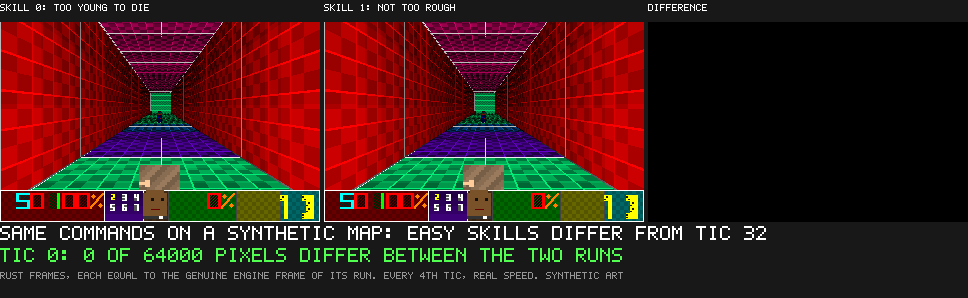

# Wire 28 evidence record (the easy skills and E1M7 on skill 3)

Observed results of wire 28 (`PlayerMonstersEpisode1V6`, captures `DSIM` 44, session state `DSES` 3), recorded 2026-11-25
(America/Los_Angeles) on branch `feat/wire28-easy-skills`, [PR #86](https://github.com/Copgunn/DOOM/pull/86). The rule and what
is admitted are in [COMPATIBILITY](../COMPATIBILITY.md#wire-28-the-easy-skills-and-e1m7-on-skill-3), the format in
[STATE_FORMAT](../STATE_FORMAT.md#dsim-v44--wire-28-the-easy-skills-and-e1m7-on-skill-3), the C facts in the
[M6a note §8](../M6A_REFERENCE_INVESTIGATION.md#8-wire-28-the-easy-skills-and-e1m7-on-skill-3-source-investigation-2026-11-25), the
commands in [TESTING](../TESTING.md#wire-28-the-easy-skills-and-e1m7-on-skill-3) and the quirk rows in the [register](../QUIRKS.md)
(Q-p_inter-799, Q-p_inter-838, Q-p_inter-894, Q-p_mobj-152, Q-p_mobj-777, Q-p_map-189, Q-g_game-828, Q-p_enemy-1909,
Q-p_pspr-255). Exact review commits and CI belong to GitHub. Only counts, pass/fail facts and map names from the commercial
IWAD appear here; nothing is said of any map's things or geometry.

**Tic convention (as in [WIRE27](WIRE27.md)).** A session tic is the 0-based index of a tic; a refusal at session tic N keeps
the state after N tics. **Everything labelled Rust-only is Rust-only:** no genuine engine ran it.

## 1. What wire 28 is, in one paragraph

Wire 27's simulation plus: skills 0 (`sk_baby`) and 1 (`sk_easy`) beside 2 and 3 (THING bit 1; at skill 0 every `P_GiveAmmo`
amount doubled before the cap and the player's damage halved before everything else); the Demon bite taking the sector-11
cap; spawn rule S'' (S' without its margin clause for monsters) with the **monster escape witness**, which refuses the tic when
an accepted move of a non-player, non-missile mover leaves the map's boundary. `doom-play` plays it for every skill. Nightmare
is refused at launch.

## 2. Decisions

The owner was not watching; each decision was taken by the orchestrating session on 2026-11-25 and is **changeable before
merge**. Options not taken are named.

| | Decision | Why |
| --- | --- | --- |
| D1 | DSIM44 is DSIM43 field for field; only the version (44), the profile (28) and `context.schema` (`PLAYER-MONSTERS-EPISODE1-6-v1`) differ, at byte offsets 4, 82 and 181. Not taken: new fields. | Nothing in the state is new: the skill is already in `actors.options`, the baby flag follows from it, and the witness keeps no state. |
| D2 | `DSES` 3 is version 2's layout with an embedded DSIM44 (`Diagnostic::decode_episode1_v6`); versions 1 and 2 are frozen. No new `DDSP` or `DSND` version: version 3 embeds `DDSP` 4 and `DSND` 3 unchanged. Not taken: redefine version 2. | Frozen formats are not redefined; wire 28 changes nothing the display or sound hold. |
| D3 | A third session configuration, `Configuration::FinaleAndMeltWire28`; `doom-play` uses it for every skill (`GameData::load_wire28_session`). Not taken: wire 28 only for skills 0 and 1 and E1M7 on skill 3, wire 27 elsewhere. | One configuration for the player; wire 28 equals wire 27 on skills 2 and 3 in the tests of section 6. |
| D4 | The Demon and Spectre bite on the player takes the sector-11 cap under wire 28 (gated on `has_easy_skills`). Under wires 24 to 27 it skipped it (p_inter.c:836-842), a silent divergence that stays frozen. Evidence: BITE2 equals the genuine engine under wire 28; wire 27 first differs at capture 97. Not taken: leave wire 28 diverging; refuse the tic. | A divergence the item showed should not be carried into the new wire; refusing would stop a legal tic. |
| D5 | The stop message for `MapScale(Escape)` is a plain sentence; it also replaces the debug text for a barrel's escape under older configurations (text only, the old text kept as its prefix; no test pins it). | A player-facing stop needs a sentence. |
| D6 | **Superseded.** The first note said to time the witness once the owner said the machine was idle. The owner's ruling of 2026-11-25 replaces it: the timing is taken only with nothing else running and said so, otherwise listed as not run. | Owner's ruling. |

Owner's rulings of 2026-11-25 for this pull request that bear on the record: existing-test changes only for expectations that
pinned skills 0 and 1 or E1M7 on skill 3 as refused, each named (section 8); the proof of wire 28 stays in this pull request.

## 3. The twelve synthetic genuine items (CI)

One WAD, [wire28.wad](../../tests/reference/wire28_wads) (nine map slots built with the M6a room builder), twelve demo scripts
under [wire28_scripts](../../tests/reference/wire28_scripts), digests in [wire28_state.txt](../../tests/reference/wire28_state.txt)
(DSIM44, through the independent encoder `tools/reference/level_snapshot_wire28.py`, never Rust output) and data in
[wire28_results.json](../../tests/reference/wire28_results.json). **Three genuine builds** (strict, overflow, address; the
address build runs with `detect_leaks=0`: leak detection disabled, not LeakSanitizer coverage) gave identical streams. Wire 28
equals the strict build at every capture of every item: **2,985 captures** (ESCAPE counts the 78 before the refusal).

| Item | Skill | Captures | Ends | What it shows |
| --- | ---: | ---: | --- | --- |
| AMMO0 / AMMO2 | 0 / 2 | 311 / 311 | complete | every `P_GiveAmmo` path of Episode 1; doubled at skill 0 only |
| DROP0 / DROP2 | 0 / 2 | 411 / 411 | complete | a dropped clip (half a clip, then doubled) and a dropped shotgun (one load, doubled) |
| HURT0 / HURT2 | 0 / 2 | 301 / 301 | complete | fireball, claw, hitscan, bite and floor damage halved before thrust and armour |
| SPLASH0 / SPLASH2 | 0 / 2 | 145 / 145 | complete | a barrel blast of 1 halved to 0 (pain roll kept, session tic 57) and a blast of 54 halved |
| BITE2 | 2 | 99 | level exits after session tic 97 | a lethal bite on a sector of special 11 capped to health 1 (tics 96 and 97) |
| BITE0 | 0 | 194 | level exits after tic 192 | the same room, every blow halved before the cap |
| ESCAPE | 2 | 171 genuine, 78 compared | Rust refuses session tic 77, `MapScale(Escape)` | two barrels (49, then a lethal 128) on an imp embedded at distance 1: momentum 22.125, one step to x = -21.125 through the wall at x = 0; the corpse slides to about x = -234 and the game goes on |
| SMALL | 2 | 278 | complete | three embedded imps (a boundary value, well inside, a diagonal) stand still while chasing; pistol and shotgun hits move none |

With the witness removed Rust equals the genuine engine at all 171 ESCAPE captures, so the refusal is the only difference. Wire 27
refuses the embedded-imp rooms (`Setup(Monster(Arithmetic))`) and wires 27 and 28 both refuse an embedded barrel
(`Setup(Monster(Arithmetic))`) and an embedded player start (`Setup(PlayerBody(Binding))`) at load.
Wire 27 against BITE2 first differs at capture 97 (the bite kills the player under wire 27; the genuine engine exits).

**Planted faults, each detected** (the port, then altered genuine builds with the p_inter.c rule removed or moved in memory):
`baby = false` in the port is caught at capture 10 (AMMO0), 321 (DROP0), 1 (HURT0), 58 (SPLASH0) and 1 (BITE0); no doubling
AMMO0 at 10 and DROP0 at 321; no halving HURT0 at 1, SPLASH0 at 58 and BITE0 at 1; halving after the thrust HURT0 at 62 and BITE0
at 97; halving after the cap BITE0 at 193; no bite cap is wire 27 on BITE2 at 97; the margin kept is wire 27's load refusal.
**Self-tests:** an extra `P_Random` draw before tic 40 of HURT0 is caught at capture 41; a SKILL1 run against SKILL0 goldens fails
(section 4). The results file was generated with the local `cc`; the CI compiler differs.

## 4. SKILL0 and SKILL1 against every genuine stream

The M6a session items SKILL0 and SKILL1 (the same scripts at skills 0 and 1) run through the wire 28 session
(`skills_0_and_1_against_every_genuine_stream`) against the genuine runner's streams at screenblocks 10 and 11:
364 tics, 685 sound rows, 210 mixer rows, 3 melts (119 steps) and the DSIM44 state over 2 levels (348 captures, screenblocks 10),
all equal. Self-test: SKILL1's run against SKILL0's goldens fails at tic 32 (health 95 against 98).

*SKILL0 and SKILL1 side by side, every 4th tic, Rust frames only; regenerate with `tools/media/wire28_readme_visual.py`.* The runs part at tic 32.
Every level frame of both runs (348 each, screenblocks 10) is the one `skills_0_and_1_against_every_genuine_stream` compares with the genuine
engine's frame digest at every tic, and the script re-checks that digest; the picture itself is Rust-drawn and synthetic.

## 5. Real maps: E1M7 on skill 3 and the owner's five sessions

Local only (`tools/local/wire28_real.py`, never in CI: it reads the IWAD in place through a symlink). Every demo runs through the
**whole session path** (`Session::new_finale_and_melt_wire28`, the session `doom-play` runs), at screenblocks 10 and 11, against
the genuine strict build (`-fwrapv`), comparing on every tic the session rows, every frame, every sound row and every melt step,
and afterwards the mixer buffers and the whole DSIM44 state after every level tic. Self-test on one run: a flipped ticcmd at tic 100
and an extra genuine `P_Random` draw before tic 200 were each reported at their tic, at both sizes.

### 5.1 E1M7 on skill 3

No recorded E1M7 run on skill 3 exists, so these are **our constructions**: the five E1M7 runs of the 61 (recorded on skill 2) with
the header's skill byte set to 3, plus 35 idle tics from the load. All six pass at both sizes: **16,459 session tics**, 0 refusals,
the whole DSIM44 state equal at every one (21 levels).

| Run | Tics |
| --- | ---: |
| M7CHAOS (4 loads) | 5,000 |
| M7DIE | 367 |
| M7FIGHT | 1,221 |
| M7IDLE (all idle commands) | 2,100 |
| M7WALK (1 load) | 7,736 |
| 35 idle tics from the load, M7IDLE's header | 35 |

**The escape witness was reached 0 times** on E1M7 at skill 3: these runs show that wire 28 plays the map equal to the genuine engine,
not that the witness is right there (that rests on ESCAPE, section 3). The imp's distance to the wall is **not recorded**.

### 5.2 The owner's five sessions of 2026-11-25

Recorded by `doom-play` of master `9da7505f` (wire 27's configuration) and replayed under **both** wire 28 (all five pass at both
sizes, every stream) and wire 27 (the unchanged ignored test `real_maps_finale_and_melt_local`: 10 runs, 34,600 session tics, 17,300
at each size). Recordings are named by their file time.

| Recording | Tics | Where it ends | Reborn loads | Melts (steps) | Result |
| --- | ---: | --- | ---: | --- | --- |
| 201221 (E1M1) | 767 | the recording's end, mid-level | 0 | 1 (42) | pass |
| 201252 (E1M1) | 623 | the recording's end, mid-level | 0 | 1 (42) | pass |
| 201426 (E1M8) | 6,503 | victory at session tic 4671, then 1,832 finale tics | 1 | 4 (155) | pass |
| 202907 (E1M8) | 5,467 | victory at 3722, then 1,745 finale tics | 1 | 4 (158) | pass |
| 203216 (E1M8) | 3,940 | victory at 3171, then 769 finale tics | 0 | 2 (85) | pass |

Level-state captures: 767, 623, 4,671, 3,722 and 3,171. No tic was refused and none differed. **Limit of the gate:** on a difference
or refusal it stops at the first one, and the whole-state and mixer comparisons come after the run, so a refusal case would need a
separate state-only check.

## 6. `DSES` version 3: restore and continue

Rust-only (a session compared with itself, not with the genuine engine). Test
`dses_version_3_restore_and_continue_at_every_kind_of_point` (`crates/doom-game/tests/wire28_session.rs`): a wire 28 session is saved
(`save_v3`), encoded, decoded, restored (`restore_v3`), re-saved (bytes equal), then continued beside the uninterrupted session to the
demo's end; every call (tic or melt step) and the final saved bytes are equal. Runs: SKILL0 and SKILL1 at their own skills, and INTFAST,
CHAIN and FINRET each replayed at skill 0 and at skill 1 (their demos were recorded on skill 2, so only restored-equals-uninterrupted
is asserted there, not agreement with a genuine golden). **60 save points**: level 8, last level tic 20, intermission 12, finale 4,
melt 24. The file's four tests pass in debug and in release. **Limit:** melt save points are the first, middle and last of all melt boundaries, not
labelled per melt kind, so the finale's text-to-art melt is not specifically asserted. The version-3 round trip, the refusals of
versions 1 and 2 and the older configurations' refusal of skills 0 and 1 are the other tests of that file (section 8).
Equality with wire 27 on skills 2 and 3: seven demos (SKILL2, SKILL3, INTFAST, REBHELD, SECRET, NOVICTOR, FINRET), 3,956 tics, 134 saved
states equal under the projection of the three differing DSIM values.

## 7. Fuzzing, by type

Three targets, Rust-only safety, cargo-fuzz 0.13.2 on nightly, options `-max_total_time=240 -seed=1 -timeout=20 -rss_limit_mb=2048`
and `-max_len` 131072 (`wire28_dsim44`), 300000 (`wire28_dses3`), 4096 (`wire28_demo3`).

- `wire28_dsim44`: `Diagnostic::decode_episode1_v6`; an accepted blob has version 44 and the DSIM43 reader refuses it.
- `wire28_dses3`: `SessionStateV3::decode`; an accepted state passes its check, re-encodes to itself, and the version 2 reader refuses it.
- `wire28_demo3`: both demo version-3 readers (`parse_demo_episode1_v3` with the map from byte 0; `SessionDemo::parse_v3`); an accepted
  demo the writer will write re-parses equal; the version 2 reader agrees on skills 2 and 3 and refuses 0 and 1.

| Target | Seed replay (address sanitizer) | Coverage-guided, **no sanitizer** | Address-sanitizer campaign, **leak detection on** (default options) |
| --- | --- | --- | --- |
| `wire28_dsim44` | 6 seeds, exit 0 | 2,553,835 runs, 241 s, exit 0 | 866,934 runs, 241 s, exit 0 |
| `wire28_dses3` | 5 seeds, exit 0 | 867,561 runs, 241 s, exit 0 | 187,630 runs, 241 s, exit 0 |
| `wire28_demo3` | 6 seeds, exit 0 | 23,045,199 runs, 241 s, exit 0 | 4,675,609 runs, 241 s, exit 0 |

No crash, no leak. **Leak detection was shown to work**: a scratch copy of `wire28_dsim44` with a planted leak
(`forget(black_box(data.to_vec()))` on an accepted input) reported "LeakSanitizer: detected memory leaks" (15,712 bytes in one
allocation, exit 77); the same binary with `detect_leaks=0` exited 0; the unmodified target leaks nothing. A first plant
(`forget(Box::new([7u8; 4096]))`) was optimised away and showed nothing, which is why it is not the one reported.
**Seeds:** made by a scratch helper that is **not committed** (6 DSIM44 captures of SKILL0 and SKILL1 at tics 0, 35 and 70; 5 `DSES`
3 states from INTFAST and from SKILL0 and SKILL1 in a level and in a melt; 6 demos, SKILL0, SKILL1 and SKILL3 bare and with a map
prefix), so the runs above are not reproducible from the repository's seeds alone. **Observed while fuzzing (not a library fault):**
the demo version-3 parsers accept a command whose button byte has its top two bits set; the writers refuse to write it and the session
refuses that command later. The four new readers are covered; the demo version-2 readers were never fuzzed (no model existed).

## 8. Tests: added, and existing ones touched

**Added** (counts are the tests below): `crates/doom-sim/src/wire28_tests.rs` (21, Rust-only: identity and skills, THING bit, demo
header, the DSIM44 differences at offsets 4, 82 and 181, the doubling and its cap, the halving and its order, S'' and the margin kept
for barrels and the player, the witness on both sides of the wall, refusal with the state kept, every non-player move carrying the
witness, the bite and its cap); `wire28_genuine_tests.rs` (3: `wire_28_equals_the_genuine_engine_on_every_item`,
`wire_27_diverges_on_the_bite_and_refuses_the_embedded_rooms`, `planted_faults_in_the_port_are_caught`);
`crates/doom-game/tests/wire28_genuine.rs` (1: SKILL0 and SKILL1, section 4); `crates/doom-game/tests/wire28_session.rs` (4: the
session starts on skills 0 to 3 and the older ones refuse 0 and 1; wire 28 equals wire 27 on skills 2 and 3; `DSES` 3 round trip,
restore and refusals; section 6); `crates/doom-play/src/wire28_tests.rs` (3: skills 0 to 3 accepted and nightmare refused; the help;
a skill 0 recording round-trips its header and replays). Fuzz targets: section 7.

**Existing tests touched** (the two whose expectations pinned the easy skills as refused; the owner's ruling of 2026-11-25), both
in `crates/doom-play/src/main.rs`, each with a dated comment: `tests::arguments` (`"--iwad a --skill 1"` left the list of refused
arguments; `4` and `nightmare` stay) and `tests::the_game_mode_flag_and_the_session_in_the_help` (`--skill 0` and `--skill 1`
now parse and give skills 0 and 1 where the test expected "easy skills (0, 1) are not built yet"). **No other existing test, fixture
or golden is changed**: everything under `tests/reference` that this branch touches is a new file, and no frozen format's
documentation was edited beyond cross-links.

## Limits

- The genuine comparison is synthetic (section 3) for everything the real maps did not reach: real E1M7 at skill 3 never brought a
  monster to the wall, so **the witness has no real-map observation of firing**. It is a refuse-the-tic witness: where a monster or a
  corpse would leave the map the session stops with a TIC REFUSED screen and keeps the demo.
- E1M7's imp distance is not recorded; the M6a note's arithmetic bounds what a blow can do, and east and north escapes are inferred,
  only west was observed.
- ESCAPE, SMALL and the rooms behind them are one room layout built to the witness; they show equality, refusal and standing still,
  not every monster, wall angle or blow.
- Wires 24 to 27 keep the bite divergence (D4); only wire 27 was observed to differ (BITE2), wires 24 to 26 share the code.
- The DSES version 3 restore test compares a session with itself, and its melt save points are not labelled by melt kind.
- Fuzz seeds are not committed (section 7). `cargo clippy --manifest-path fuzz/Cargo.toml --bins -- -D warnings` fails on an existing
  file, `game_input_events.rs` (`manual_range_patterns`), not on a wire 28 file.
- `Snapshot::diagnostic_bytes` handles versions 20 to 40 only and refuses 44; DSIM44 bytes come from `snapshot().canonical_bytes()`.
- `StartError::Domain`'s text still says "skill 2 or 3" (shared with frozen configurations; API only).
- Not checked here: nightmare (refused), skills 0 and 1 beyond the items and the real maps recorded above, and any other episode.
